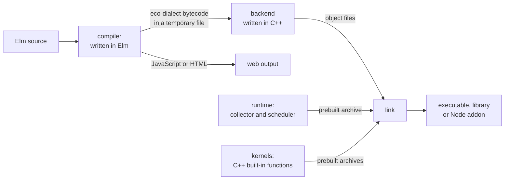

# Eco

Eco compiles whole Elm programs to native code by specializing every function to concrete types, handing the result to LLVM through a single custom intermediate language, and running it on a small runtime whose garbage collector is simple because Elm values never change. It exists so that Elm can run outside the browser as fast native programs, such as command-line tools, servers and the Eco compiler itself, with Elm's meaning unchanged. Users install one `eco` command. Inside it, a compiler written in Elm checks the program, specializes it and writes it out in that intermediate language. A back end written in C++, running in the same process, turns the result into machine code and links it with the runtime and with C++ implementations of Elm's built-in functions. A catalog of numbered rules keeps the two halves consistent, and the compiler tests the whole toolchain by compiling itself.

## What Eco accepts and what it produces

Eco accepts ordinary Elm. Its front end is a fork of Guida, a port of the standard Elm compiler into Elm, so existing Elm source, packages and error messages carry over unchanged. Eco adds back ends, not a language: Guida's own syntax extensions are removed so that the language Eco accepts stays exactly Elm.

The file name the user asks for chooses the output. A name with no extension, or one ending in `.o`, gives a native executable or object file. A name ending in `.so` or `.node` gives a shared library or a Node addon, so a compiled Elm program can be embedded in another application. A name ending in `.js` or `.html` gives JavaScript or a web page, as stock Elm does, and `.mlir` gives the intermediate code for inspection.

Eco leans on three guarantees that Elm makes about every program it accepts. A value is never changed once the program can see it. Effects happen only through the runtime, as tasks, effect managers and ports. And there is no dynamic code loading, so the whole program is known at compile time. The governing ideas below follow from these guarantees and from one fact about Eco itself: its compiler is split across two languages.

## The governing ideas

Five ideas explain most of Eco's design. The first two turn Elm's guarantees into a simple runtime and fast code. The next two keep the Elm half and the C++ half consistent. The last is how Eco shows that the whole stack works.

### Values never change, so the collector can be simple

Once an Elm object is built and the program can see it, nothing writes to it again, and Eco's garbage collector is built on that fact. A generational collector keeps young objects apart from old ones so it can collect the young ones often and cheaply. It normally needs a write barrier: extra code on every store that records when an old object comes to point at a young one, so that collecting the young generation does not miss that reference. In Elm an old object can never point to a younger one, because the younger one did not exist when the old one was last written. Eco's collector therefore has no write barrier. It collects the young generation, the nursery, by copying the reachable objects out of it, and because it moves objects it must know exactly which stack slots hold heap pointers; the back end arranges that with LLVM.

What the collector depends on is that values never change, not that they are acyclic. Elm values can form cycles. A recursive closure captures itself, and mutually recursive closures capture each other while they are being built, with each store going into an object the program cannot yet see. The collector traces cycles like any other graph.

The runtime and the kernels do build objects in place, so they keep the same rule by hand. They write only into objects that are still under construction and invisible to the program, and they keep any state that really changes outside the heap, registered with the collector as a root. Generated code stores only into objects it has just allocated.

Each process has exactly one mutator, the thread that runs Elm code and allocates, and the runtime calls it the eco thread; starting a second one aborts. Several live heaps in one process cost more than they return. The collector's accounting of committed memory, the timing of handing memory back to the system and the list of released memory are shared by the whole process, so each extra heap would need its own reservations, caps and page accounting, and only benchmark and test harnesses ask for more than one heap. With one mutator, the scheduler can run all of Elm on a single thread and the collector's behavior stays deterministic.

Other threads exist, and they come in two kinds. Collector helper threads mark the old generation and promote survivors in the background, again without a write barrier: anything reachable when marking starts stays reachable through objects that existed then, and everything allocated afterward is treated as live until the next cycle. Service threads, such as IO workers, the HTTP worker and the network thread, never touch the heap. They hand plain values back to the eco thread, which builds the Elm values. Child processes are started by spawning, never by forking, because a fork would copy the live heap, the collector's state and the runtime's global objects into the child.

Running Elm on many threads over one shared heap is ruled out. It would need references between threads' young objects, or stop-the-world minor collections with safepoint polls, plus a marking handshake with every mutator and further formal models, and the JavaScript back end could not offer the same behavior. The direction decided for parallel Elm is a heap per thread, each with one mutator, with threads exchanging only messages. It is not built.

### The whole program is known, so every function is specialized

Elm has no dynamic loading, and every kernel is reached from known Elm code, so the compiler sees every use of every function. It starts from `main` and makes a separate copy of each polymorphic function for each concrete type it is used at, a step called monomorphization. The back end can then store Int, Float and Char unboxed and call functions directly. Boxing every value, as the JavaScript back end does, costs too much at run time to be the native design. A type variable that no use constrains stays boxed everywhere, so a value of unknown type always has one layout.

Specialization needs the types that type checking finds, and Elm's optimizer throws them away. Eco keeps a parallel, typed version of the optimized program instead of changing Elm's erased one, so JavaScript generation keeps working exactly as in Elm. That is why the compiler has two paths, chosen once per build by the output format: a typed path for native code and MLIR, and an erased path for JavaScript and HTML. The two share parsing, name resolution and the type checker, and split after it.

### One value, four representations, linked only by numbered rules

The same Elm value takes different forms in different places, and Eco treats them as four separate models. The ABI form is how the value is passed across a function call. The SSA form is how it appears in the intermediate code, where every value is defined exactly once. The heap form is how it is stored in an object field or a closure at run time. The logical form is what it means in Elm. Each model has its own rules, and only numbered rules link one model to another.

The models are kept apart because the commonest code generation bug in Eco is a phase assuming that one form of a value implies another, so that a value's declared type no longer matches how it is really stored. Bool is the standard case. In SSA a Bool is a one-bit integer, but in heap fields, in closures and at call boundaries it is a boxed value: one of two constants embedded in the pointer word itself, never an object on the heap. A phase that stores a Bool unboxed in a heap field because it is a single bit in SSA corrupts the heap. Only Int, Float and Char are ever stored unboxed, and a value changes form only at a few named seams, such as calls, captures, construction and projection ([value-representation.md](design_docs/theory/value-representation.md)).

The numbered rules live in one flat catalog, grouped by area: representation, code generation, heap layout, forbidden assumptions, and others. Each phase is written and tested against the rules rather than against what its neighbors happen to do, so one phase can change without its author re-reading every other phase. The catalog is needed because no type system sees across the boundary: Elm's stops at the intermediate code, and C++'s stops at the kernels. No build step reads the catalog. Checks, code comments and tests cite rule numbers, and review keeps the rows in step with the code. Some rows are out of date, so where a row and the code disagree, trust the code and fix the row.

### A custom dialect between the Elm half and the C++ half

MLIR is a framework for defining typed intermediate languages, called dialects, and lowering them step by step toward LLVM. Eco defines its own dialect, and everything that crosses from the Elm compiler to the C++ back end is an operation in it. The front end is an Elm program and cannot call MLIR or LLVM libraries, so whatever crosses has to be written out. The compiler writes the dialect as MLIR bytecode to a temporary file, then calls a kernel function that runs the C++ lowering inside the same process. A dialect of Eco's own lets the C++ passes reason in Eco's terms, such as boxed values, constructors, closures and groups of allocations, before LLVM sees anything.

Each operation has a verifier, and it checks what that single operation shows: its operand types, its result types and its attributes. Facts that span operations, such as the memory layout of a constructor or the signature a call must match, cannot be seen one operation at a time. Those are covered by the numbered rules instead, and by the tests that check them.

The compiler decides such cross-operation facts once, upstream, and attaches each decision to the operations as an attribute: a value's layout, how each call is made, a kernel's calling convention. The C++ passes read these decisions and never work them out again. A lowering pass that derives a kernel's calling convention for itself drifts away from what the compiler emitted, and the two halves stop agreeing.

### The compiler compiles itself

The compiler is a large Elm program that allocates heavily, so compiling it natively exercises the whole stack. A staged chain starts from the stock Elm compiler, the only trusted ancestor, which can build only a JavaScript program. From there the chain builds a JavaScript Eco, then a native Eco, and at two points checks for a fixed point: the compiler rebuilds itself and gets byte-for-byte identical output. Those fixed points show that the native compiler behaves like the JavaScript one. Two end-to-end gates run early in the chain, one through the in-memory just-in-time (JIT) runner that the tests use and one through the ahead-of-time (AOT) compiler that users run, so that, run in the documented order, they report a back-end regression before the slow self-compiles start.

The JavaScript back end stays for the same reason. It is the first link of the chain and the reference for correct behavior.

## The parts

Nine parts make up Eco. Four are what a program passes through or runs on: the compiler, the back end, the runtime and the kernels, in the order a program meets them. Two follow a single concern through several of those: how a call through a function value is made, and the forms a value takes. Three hold the rules, the tests and the build.

The compiler turns Elm source into eco-dialect MLIR in two halves with a cache between them. The first half compiles each module on its own (parse, resolve names, type check, Elm's pattern checks, and the local optimizations that need no concrete types) into a cached graph, which keeps its types when the output is native code. The second half links every module into one typed program and runs a fixed list of whole-program steps over it: monomorphize, inline, prune, optimize, then write the result out as MLIR. The build and the tests run the same list, so a test sees exactly the program the build sees. See [compiler.md](design_docs/theory/compiler/compiler.md).

The back end turns eco-dialect MLIR into native code in one fixed sequence. A stack of small MLIR passes lowers the eco dialect to LLVM's own dialect. LLVM then rewrites every point where the collector might run so that it records which stack slots hold heap pointers, which is what lets a moving collector find and update every reference. LLVM optimizes and emits object files in parallel partitions, and a per-platform link step joins them with the prebuilt runtime and kernel archives. Every whole-program fact is settled in MLIR before the partitions split, because an MLIR context can be shared between threads and an LLVM context cannot. The JIT and AOT paths share all of this code and differ only in the final step, since two pipelines kept in step by hand would let programs built one way behave differently from programs built the other. See [backend.md](design_docs/theory/backend/backend.md).

The runtime is what a compiled program runs on, and it has two halves linked into every executable. One is the garbage collector described above. The other is a cooperative scheduler that gives Elm's tasks, effect managers, timers, HTTP and ports a single thread, the eco thread, to run on. See [runtime.md](design_docs/theory/runtime/runtime.md).

The kernels are how Elm's built-in functions, and Eco's own IO libraries, reach native code. A kernel is a function the compiler treats as having no Elm body. Elm source names it under `Elm.Kernel` or `Eco.Kernel`, and the compiler turns each use into a call to a C++ function that works directly on the Eco heap. Three C++ libraries supply them: Elm's own kernels, ported from their JavaScript originals so that unmodified Elm packages run; the compiler's private IO layer; and the public `eco/system` library for files, processes, sockets and an HTTP server. `eco/system` has no HTTP client; programs make HTTP requests through Elm's own `elm/http`, whose kernel is among Elm's kernels. The compiler alone decides how each kernel is called, and the C++ decides only what it does. See [kernels.md](design_docs/theory/kernels/kernels.md).

Closures and calls run from the compiler through the back end to the runtime. Every Elm function value is a closure on the heap, and its header records everything needed to apply it: how many arguments its current stage takes, how many it already holds, the kind of every slot and of its result, and a static descriptor with one uniform entry point. The runtime can therefore apply any closure to any number of arguments with no static knowledge of it. The compiler emits a faster call only where it can prove that call correct, and every other call goes through this generic apply. See [closures-and-calls.md](design_docs/theory/closures-and-calls.md).

Value representation follows one value through the four models. Outside the body of a single function, every value except an Int, a Float or a Char is one 64-bit word, and one bit of it says whether the word is a heap address or a constant embedded in the word itself. Int, Float and Char are raw machine values at calls, in closures and in heap fields, and Bool is a one-bit integer only inside a function. Every heap object whose fields can hold a raw number records a two-bit kind for each field, so the collector tells a raw number from a pointer without knowing any types, and the compiler computes each object's layout from the value's type, the same way at every site that builds or reads one. A value changes form only at six seams, each with one conversion operation. See [value-representation.md](design_docs/theory/value-representation.md).

The invariants and design records hold the rules every phase obeys and the reasons behind them. Every phase from name resolution to the runtime heap is bound by numbered rules in the catalog. The rules that define the four representation models come first, and every other block of rules is read in their terms. The reason for a decision lives in the plan or design note that caused it, and the rule, the code comments and the commit message all point back to that note. The repository's coding and commit conventions sit alongside. See [invariants-and-design.md](design_docs/theory/invariants/invariants-and-design.md).

Verification is how Eco knows it is correct, and it layers checks so that each class of bug meets the cheapest check that can catch it. The compiler's intermediate forms are checked structurally against the rules, without running anything. Whole Elm programs carry their expected output as comments and run on the JIT and AOT paths, and the system library's programs run on the JavaScript path too. Generated MLIR and each lowering pass are compared with expected text. The runtime has unit and property tests. The collector's concurrency is described in formal TLA+ models, with a canary that reports when the code a model describes changes. Every layer exists to make some numbered rule tested or enforced. See [verification.md](design_docs/theory/verification/verification.md).

Build and workflow cover how Eco is built, bootstrapped and developed. One CMake tree runs the compiler's self-compiling chain as ordinary build targets, so building Eco and testing that it can compile itself are the same act. Work is driven by written plans and by loops that measure one change at a time, because the system is large and slow to rebuild, and a mistake in it can easily go unnoticed. See [build-and-workflow.md](design_docs/theory/workflow/workflow.md).

## Shipping one tool

Eco is distributed as a single `eco` binary per platform (Linux x86_64, macOS arm64 and Windows x86_64), and each choice below keeps that binary self-contained and portable.

The Elm front end and the C++ back end live in one process because users should install one tool. Two cooperating executables would keep the cost of shipping and starting two programs and of piping one into the other. The C++ side owns the program's entry point, because the collector and the scheduler start up there.

Generated code targets a fixed CPU model for each architecture rather than the machine doing the compiling. The compiler is itself a binary that Eco builds. Tuning for the host CPU puts that machine's instructions, such as AVX-512, into the bootstrapped compiler, which then crashes with illegal-instruction errors on machines without them.

On Linux the toolchain is statically linked against the musl C library and carries its own linker and runtime archives, so it depends on neither the host's C library nor its linker. Static linking against glibc breaks DNS and user lookups, which a compiler that builds network programs cannot accept.

## Changing Eco

A change fits Eco's theory when it decides a fact once, in the compiler, and carries it through the dialect; when it leaves published values unchanged; and when it adds or amends a numbered rule wherever it links two representations. A change that works around one of these breaks the theory. The structure stays visible, but it stops doing its job.

### Examples of changes that fit the theory
- An optimization that decides which code exists or how it is called belongs in a named compiler phase, behind a switch in the compiler's configuration. A switch that can change generated code contributes to the settings hash that keys the build cache, so a build never reuses results made under other settings. It comes with a rule and a test, and it is turned on by default only after measurement shows it pays. Promoting non-escaping values to SSA aggregates, and returning large results through memory the caller supplies, are both switches of this kind.
- A representation idea becomes a dialect operation with a verifier, a lowering pass that establishes one fact about it, and rules that link the models it touches. The non-escaping aggregates have exactly this shape: a value that provably does not escape its function is built as a plain aggregate in SSA, by operations beside the heap ones, and never costs a heap allocation.
- A kernel or IO capability is an Elm declaration, a C++ function that works on the Eco heap, and a calling convention that the compiler owns. Blocking work goes to a service thread that hands back plain values. The sockets, WebSockets and HTTP server in `eco/system` are built from these pieces and touch no compiler phase.
- An output kind or a platform is a branch in the native driver's output dispatch, or a build preset, a CI workflow and platform-specific code, with the compiler phases left alone. Embedding as a shared library or Node addon, and the macOS and Windows ports, are examples.
- A collector mechanism fits if it keeps two properties: no old object points to a younger one, and the collector writes nothing the program can read. It also needs heap validators, a TLA+ model if it runs concurrently, and a hash pin in the canary's manifest, so that drift between model and code is noticed. Before touching the collector's concurrency code, read the models' README.

### Examples of changes that would break the theory
- Letting a C++ pass work out again a fact the compiler already decided, such as a type, a memory layout, how a call is made, or a kernel's calling convention. Two derivations of one fact drift apart, and nothing checks that they agree. Decide it once in the compiler and carry it as an attribute.
- Mutating a published heap object, or adding a write barrier, to make a feature easier. The nursery copy and the background marking both depend on no old object ever gaining a pointer to a younger one. Build a fresh value, write into an object still under construction, or keep the changing state off the heap as a registered root.
- Inferring one representation's rules from another's, for example storing a Bool unboxed because it is a single bit in SSA. The models are independent, so the inference is wrong as soon as their rules differ, and the result is a corrupted heap or a mismatched call. Amend or add a rule that links the two models explicitly.
- Treating a kernel specially by name in a later phase. That makes a second place that decides how the kernel is called, and it will disagree with the compiler. Extend the compiler's tables of kernel calling conventions and kernel facts instead.
- Adding a second eco thread, or a second heap, to get parallelism. The scheduler, the collector's determinism and the service-thread contracts all assume one mutator. Put parallel work on service threads that exchange only plain values; parallel Elm waits for the heap-per-thread design, which is a project of its own.
- Making the JavaScript and native paths share a partly typed program, or teaching the JavaScript back end about specialized types. The erased path stays identical to Elm's so that it can serve as the bootstrap's reference, and the typed path is free to carry everything specialization needs. Put typed work on the typed path.
- Recording the reason for a decision only in a plan. Readers find reasons by following the rule, the code comment and the commit message, so the reason has to reach those.

## References

Children: [compiler.md](design_docs/theory/compiler/compiler.md), [backend.md](design_docs/theory/backend/backend.md), [runtime.md](design_docs/theory/runtime/runtime.md), [kernels.md](design_docs/theory/kernels/kernels.md), [closures-and-calls.md](design_docs/theory/closures-and-calls.md), [value-representation.md](design_docs/theory/value-representation.md), [invariants-and-design.md](design_docs/theory/invariants/invariants-and-design.md), [verification.md](design_docs/theory/verification/verification.md), [build-and-workflow.md](design_docs/theory/workflow/workflow.md).

Code and documents:

- `Readme.md`, `docs/getting-started.md`, `docs/bootstrap.md`, `docs/options.md`: what Eco is, how it builds itself, and every setting.
- `compiler/src/Terminal/Make.elm`: output dispatch by file name, the choice between the typed and erased paths, and the hand-off to the native back end.
- `compiler/src/Compiler/Pipeline/Steps.elm`, `compiler/src/Compiler/Eco/Config.elm`: the shared whole-program step list and its switches (`aggPromote`, `sretResults` and the others).
- `runtime/src/codegen/Ops.td`: the eco dialect and its verifiers.
- `runtime/src/codegen/EcoNativeDriver.cpp`, `runtime/src/codegen/EcoNativeAPI.h`, `eco-kernel-cpp/src/eco-kernel/NativeDriver.cpp`, `runtime/src/codegen/eco_entry.cpp`: the in-process back end, its C interface, the kernel that calls it, and the program entry point.
- `runtime/src/codegen/EcoBackend.h`: the fixed CPU targets (x86-64-v3, apple-m1).
- LLVM's RewriteStatepointsForGC pass and its stack maps: how the back end makes collection points precise.
- `runtime/src/allocator/`, `runtime/src/platform/`: the collector and the scheduler.
- `elm-kernel-cpp/`, `eco-kernel-cpp/`, `system-kernel-cpp/`: the three kernel libraries.
- `CMakeLists.txt`, `CMakePresets.json`, `.github/workflows/`, `version.txt`: the build graph, platform bundles, CI, the kernel license and TLA+ canary guards, and the version.
- `test/tla/README.md`: the formal models of the collector's concurrency.
- `design_docs/compatability.md`: the CPU and C library choices.
- `design_docs/multi-threaded-eco/01-baseline-and-boundary.md`: one mutator per process, the rejected shared heap, and the heap-per-thread direction.

Invariants (`design_docs/invariants.csv`):

- REP_*, CGEN_*, HEAP_*, FORBID_*: the representation models, code generation, heap layout, and forbidden assumptions.
- HEAP_005, HEAP_031: generated code stores only into fresh objects.
- HEAP_BUILDER_001: objects under construction in the runtime and kernels.
- HEAP_007: one mutator per process. GC_DET_001: the collector's determinism.
- HEAP_018: Elm value data is acyclic; closures of recursive local functions are the exception and can form cycles.
- XPHASE_010: code generation trusts the compiler's call information.
- KERN_006: the compiler alone decides kernel calling conventions.
- MONO_029: unconstrained type variables are boxed.
- SYS_003, SYS_004: service threads return plain values to the eco thread. SYS_007: spawn, never fork.
