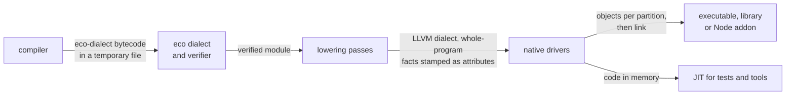

# Backend

The backend turns the eco-dialect module that the compiler writes into native code, always in the same order. It loads the module and checks it with the dialect's verifier. A stack of small MLIR passes lowers it to LLVM's own dialect and settles every fact that needs the whole program. LLVM then rewrites each call where the collector might run so that the call records which stack slots hold heap pointers, optimizes the code and emits object files, in parallel partitions for a large program. A link step chosen per platform joins the objects with the prebuilt runtime and kernel archives. The just-in-time (JIT) runner that the tests use and the ahead-of-time (AOT) compiler that users run share all of this code and differ only in what they do with the finished code.

## What the backend decides, and what it does not

The backend makes no decision about what a value means or how it is stored. The compiler has already chosen types, memory layouts, how each call is made and how each kernel is called, and has written those choices into the dialect as operations and attributes. The backend turns each choice into machine code and never works one out again, because two derivations of the same fact drift apart and nothing checks that they agree.

What the backend does decide is how to make that code safe for a moving collector and how to produce it quickly. Two forces shape nearly every choice in it. The collector moves objects, so at every point where it may run, every live heap pointer must be known exactly and must be updatable. And the largest program the backend compiles is the Eco compiler itself, a single module of tens of thousands of small functions, so compile time decides the shape of the pipeline.

## The three parts

The backend has three parts, in the order a module meets them: the dialect that defines what the backend accepts, the passes that lower it, and the drivers that turn the lowered module into something that runs.



The eco dialect is the typed contract between the Elm-written front end and the C++ back end. It has one opaque type for boxed values, plain integer and floating-point types for unboxed ones, and a small family of aggregate types that exist only in the intermediate code and never in the heap. A sibling dialect handles fused encoding and decoding of byte sequences ([bytes-fusion.md](../compiler/bytes-fusion.md)). The verifier checks only facts that one operation shows and that are cheap to test: the shape of a case expression, that each stored field has the kind its operand has, that no single-bit value goes into a heap or closure slot, and limits on object size. It does not check that a direct call matches its callee's signature, or the tuple and list layout attributes that the lowering trusts. See [eco-dialect.md](eco-dialect.md).

The lowering passes run in a fixed order, and each sits where one fact first becomes decidable: once every kernel declaration exists, once types have been converted, or once the module is final. Each pass records its fact as an attribute, a declaration or a module flag that later stages rely on. The order is the design: a fact is decided where its inputs are still visible and where nothing later can invalidate it. The whole-program facts come last, still in MLIR, so that the LLVM work after them can run on each partition separately. See [lowering-passes.md](lowering-passes.md).

The native drivers turn the lowered module into something that runs. An in-process JIT serves the tests and the developer tools. The AOT pipeline partitions the module in MLIR, emits objects in parallel and links them into a self-contained binary. An embedding layer exposes a compiled program as a library to C and Node hosts. One lowering pipeline sits under all of them, and they differ only in what happens after it. See [native-drivers.md](native-drivers.md).

## The path of one module

The compiler writes the module as MLIR bytecode to a temporary file and calls the backend, which is compiled into the same `eco` executable. Before lowering starts, the front end's heap is released, since it would otherwise stay resident through all of the LLVM work. The backend loads the module with the eco dialect and the byte-sequence dialect registered, and runs the verifier.

The passes then work in stages. Eco operations are first simplified among themselves, then lowered to MLIR's standard dialects for functions, control flow and arithmetic. The module is prepared for garbage collection and lowered to the LLVM dialect. Three whole-program steps close the sequence: a reachability analysis that finds which functions can ever run, a plan for hoisting nursery capacity checks from callees into callers, and stamps on the functions that can never trigger a collection.

For an optimized executable, the module is split into partitions while it is still in MLIR. Each partition is translated to LLVM's own form on its own thread, and one shared routine compiles it. The routine expands the inline fast paths that the lowering left as placeholder calls, applies the stamped plans, rewrites collection points, optimizes and emits an object. The order of those steps carries the safety argument:

```text
runEcoBackend(llvmModule, job):          # once per partition on the split path
  check the plans stamped in MLIR (leaf functions, capacity hoisting)
  expand markers: tag tests, list projections, string length,
                  value-equality fast path, heap dereference
  apply capacity hoisting                # allocation markers still carry constant sizes
  expand allocation markers
  check the leaf stamps
  rewrite statepoints; add frame pointers where a statepoint exists
  optimize
  emit an object, print LLVM text, or hand the code to the JIT
```

From `runtime/src/codegen/EcoBackend.cpp`, trimmed to the steps this document discusses.

Every marker expansion and every plan check happens before statepoint rewriting, so the rewriting sees the final calls and the final heap-pointer values. Statepoint rewriting happens before the optimizer on every default path. The sections below give the reason for each of those orderings.

The link step then binds the objects to the runtime, the kernels and a small entry stub. It finds the runtime archives through an override in the environment first, then next to the `eco` binary in its bundle, then in the build tree.

## Finding every heap pointer

The collector moves objects, so at every point where it might run, called a safepoint, it must know every stack slot and register that holds a heap pointer, and it must be able to replace each one with the object's new address. LLVM can compute this itself if it can tell heap pointers from other pointers. The backend therefore lowers every boxed value to a pointer in a separate address space, which Eco's collector strategy tells LLVM holds garbage-collected memory. LLVM's RewriteStatepointsForGC pass then works out which of those pointers are live across each call that might collect, and replaces the call with a statepoint: a call that records the live pointers in a stack map and gives back their possibly moved values. Liveness alone decides the roots, and the compiler supplies none. Eco adds only a collector strategy, which tells LLVM how to lay out the stack maps, and annotations on helper functions that cannot collect.

Eco does not write its own statepoint conversion, with markers placed before calls and roots spilled and rewritten by hand. Once heap pointers have their own address space, LLVM's pass does the same job from liveness, and keeping a second copy of that logic would mean two implementations that must agree.

Frame pointers are added only to functions that contain a statepoint. The stack must be walkable through every frame that can be stopped at a collection, and functions that can never collect keep the register for other uses.

The stack maps go into a special section of each object file, and at run time the collector reads that section from the running image to find the roots. Every link and strip step must therefore keep the section. The section's name, its location and the relocations it needs differ between object formats, which is why each platform's handling of it is a separate, explicit piece of code.

## Keeping integers away from statepoints

Compiled code sometimes reads a heap pointer as an integer, for example to test a tag bit. If that integer is still in use after a call that becomes a statepoint, the object may have moved and the integer is stale. So no integer derived from a heap pointer may live across a statepoint. Until statepoint rewriting has run, conversions between pointers and integers in boxed slots are written in a form LLVM cannot fold away, either a barrier call or a typed load. Without that, inlining and instruction combining could remove the conversion and leave a stale integer in its place.

The same danger fixes the position of statepoint rewriting. LLVM intends it to run after the optimizer, but there the optimizer can move a pointer-to-integer conversion across a call that is about to become a statepoint, and the checks in a release build would not catch the stale tag that results. Eco therefore rewrites statepoints first and optimizes afterward. The other order is available as an option and is off by default.

## Fast paths as markers, not runtime calls

Every call from compiled code into the runtime might collect, so it becomes a statepoint, with stack map entries and pointers spilled around it. The commonest runtime operations therefore do not stay as calls. Allocating from the nursery (the young-object area, where allocation is a pointer bump), reading a field through a heap pointer, extracting a constructor tag, projecting list fields and testing two values for equality are each lowered to a call to a marker: a declared function with no body. Just before statepoint rewriting, the backend replaces each marker with inline code that does the work directly on garbage-collected pointers. Markers are needed because the lowering often works inside single-block regions, where it cannot build the branches the inline code needs; after translation to LLVM those branches are easy to build.

The inline code re-implements the runtime's own fast paths: how a heap pointer is encoded ([value-representation.md](../value-representation.md)), the layout of an object's header word, nullary constructors as embedded constants, the nursery's bump state and how a moved object is forwarded. The expansions and the allocator must therefore change together.

## Whole-program facts are settled before the split

Two analyses need to see the whole program. A function that calls only functions which cannot collect can itself never collect, so it is stamped as a leaf, and statepoint rewriting skips it. A callee's nursery capacity check can move into its caller when the caller can prove the total allocation budget. Both run in MLIR before the module is split, and their results travel as attributes that each partition checks again locally. They are computed in MLIR because an MLIR context can be shared between threads while an LLVM context cannot, so a fact decided before translation is available to every partition at no extra cost.

These analyses, and the reachability step that drops functions that can never run, all assume a closed world. An executable exposes only its entry point and the global initializer, so no caller outside the program can break an assumption about who calls what.

## Built for compile time

The lowered program is one large module of very many tiny functions, and the backend is organized to use many cores on it. Passes process functions in parallel chunks at the module level rather than nesting a pass per function: the nested form serializes on MLIR's pass instrumentation, and with functions this small the cost of scheduling them outweighs the work. Symbol lookups go through caches instead of scans of the module. Release builds skip verification between passes. Translation, optimization and emission run per partition, and the full optimization level runs on every partition by default.

Each serial step before the split would cost the parallelism it precedes, so the backend keeps none. A whole-program LLVM step that propagates constants and removes dead globals before splitting gains almost nothing, since reachability already runs in MLIR and the compiler folds constant thunks (top-level values that need no input) itself. Writing the whole translated module out and re-reading it in each worker costs a serial serialization that splitting before translation avoids. LLVM's own module splitter is used only for configurations that cannot split in MLIR. Development builds get their speed from turning optimization off entirely; a lighter optimization level measures no faster than the full one.

## One routine for every tool

The product `eco` compiler, the bootstrap compiler, the developer tool that prints the module after any stage, and the test JIT all compile through the same routine. Separate copies of target setup, statepoint rewriting and frame-pointer handling in each tool drift apart in step order: one tool sets the data layout before rewriting and another after it, or one path loses its frame pointers, and programs built one way then behave differently from programs built another. The choice of how many partitions to use lives in the shared routine too, not in the drivers, for the same reason.

## A link that needs nothing from the host

Users must be able to unpack a bundle and run `eco make` with no toolchain installed. The link step therefore uses absolute paths into the bundle's own runtime directory, which carries static libraries for the C and C++ runtimes, the unwinder, the memory allocator, and a static copy of the LLVM linker. [native-drivers.md](native-drivers.md) gives the link mode for each output kind and platform.

The bundled linker runs as a separate process, not inside `eco`. Embedding it is set aside because the stack map section carries absolute relocations, which the linker refuses when it builds a position-independent executable. Running a C++ compiler as the link driver, or searching the host for C library start-up files, would make the result depend on whatever happens to be installed, so the link step does neither.

The target CPU is fixed per architecture rather than detected, for the reason the parent document gives: detection puts the build machine's instructions into the bootstrapped compiler, which then crashes on other machines.

## Two designs Eco does not use

Two plausible optimizations are left out, one because it is ineffective at this level and one because it is unsound.

Escape analysis and unboxing of aggregates as passes over the lowered MLIR do not work. At that level almost every construct looks as if it escapes, a yes-or-no escape answer is too coarse, and eligibility depends on details of the callee; the measured result allocates more, not less. Which values stay out of the heap is decided by the compiler, which emits the aggregate operations directly. The backend keeps the mechanism: the aggregate types and operations, returning aggregates through a slot the caller supplies, and an ordering that promotes them to registers and folds field extraction before statepoint rewriting.

Merging identical allocating operations, as common subexpression elimination would at the MLIR level, keeps memory alive longer and also changes results, because object identity is observable through the equality of values that contain a NaN. Enabling it soundly needs allocation effects on the operations and knowledge of which kernels can reach a Float. [lowering-passes.md](lowering-passes.md) gives the NaN case where it describes the slot the pass would occupy.

## What the backend trusts

The backend is correct only if five things outside it hold. The front end meets the dialect's contract: typed signatures, explicit layout attributes, the remaining arity on partial applications, and kernel declarations whose calling conventions the compiler computed; the lowering does not repair them. The four representation models stay independent, and the backend never infers one from another. The heap layout and the allocator are exactly what the inline expansions assume. The stack map section survives linking, since the runtime walks every stack map block in the image. And runtime and kernel symbols resolve by name: the JIT registers them explicitly while AOT links the same archives statically, so a symbol missing from the JIT's registration shows up only when the JIT tests run.

## Changing the backend

A change fits when it carries out a decision the compiler made rather than making one, keeps every heap pointer visible to statepoint rewriting, and keeps whole-program work in MLIR so that the LLVM side stays parallel.

### Examples of changes that fit the theory
- A fast path for a hot runtime operation: a bodiless marker in the lowering, and inline code in the backend's expansion, written on garbage-collected pointers and placed before statepoint rewriting, with the runtime symbol registered for the JIT and a rule added to the catalog. Field reads, nursery allocation, the equality fast path and list projections all have this shape.
- An analysis that needs the whole program: an MLIR pass that stamps attributes before the split, which each partition checks again locally. Reachability, capacity hoisting and the leaf stamps are built this way.
- A platform or output kind: a branch in the link step and its own explicit handling of the stack map section, with the lowering left alone. The macOS link, the Windows link and the glibc set for shared libraries are examples.
- A kernel intrinsic or typed operation: an operation in the dialect, its verifier and a lowering pattern, plus rules for the models it touches, keeping the boxing rules of the representation models.
- A diagnostic: behind an environment switch or the lowering validation setting, so that release builds still skip verification between passes.

### Examples of changes that would break the theory
- Emitting a runtime call on a hot path from the lowering because it is quicker to write than a marker. Each call is a statepoint with its spills; write a marker and its expansion, or call a helper that cannot collect.
- Letting an integer derived from a heap pointer live across a call, or removing a fold-proof conversion because it folds correctly in one case. The next inlining decision can make it stale. Fix the representation crossing instead.
- Adding a serial whole-module LLVM step before the split. It costs the parallelism of everything after it; compute the fact in MLIR and pass it down as an attribute.
- Expanding a marker after statepoint rewriting, or adding a step that does. Any call or pointer conversion it creates is invisible to the rewriting. Place it with the other expansions.
- Marking a function as a leaf by name or by hand. A wrong mark leaves a collecting call with no stack map. Only the propagation pass stamps generated functions, and LLVM's statepoint pass defines what counts as a leaf.
- Giving one tool its own copy of statepoint rewriting, data layout or frame-pointer setup. The copies drift and the tools stop agreeing; route the tool through the shared routine.
- Detecting the host CPU, or searching the host for C library files during the link. Either ties the output to the build machine; use the fixed targets and the bundle's own archives.
- Working out a kernel's calling convention in the lowering, for example from its name. It will disagree with the compiler; extend the compiler's kernel tables.
- Merging or dropping allocating operations with generic elimination passes that do not model allocation. Object identity is observable through NaN equality, so model allocation effects first.

## References

Parent: [eco.md](../../../THEORY.md). Children: [eco-dialect.md](eco-dialect.md), [lowering-passes.md](lowering-passes.md), [native-drivers.md](native-drivers.md).

Code:

- `runtime/src/codegen/EcoPipeline.cpp`, `runtime/src/codegen/EcoPipeline.h`: the ordered pass list and the comments that state its ordering rules; `ecoMlirCseEnabled` for MLIR CSE.
- `runtime/src/codegen/EcoBackend.h`, `runtime/src/codegen/EcoBackend.cpp`: `runEcoBackend`, `BackendKind`, the marker expansions (`expandInlineDerefs`, `expandInlineAllocs`, `expandGetTagMarkers`, `expandValueEqFastPath`), `rs4gcAfterOpt`, `kEcoTargetCPU`, `choosePartitionCount`.
- `runtime/src/codegen/Passes/EcoGCStrategy.cpp`: the collector strategy.
- `runtime/src/codegen/Passes/EcoPtrIntVerify.cpp`, `runtime/src/codegen/Passes/EcoSlotCastBarriers.h`: pointer-to-integer fencing.
- `runtime/src/codegen/EcoSplit.cpp`: partitioning in MLIR.
- `runtime/src/codegen/EcoNativeDriver.cpp`, `runtime/src/codegen/EcoNativeAPI.h`, `runtime/src/codegen/EcoBootConfig.cpp`, `runtime/src/codegen/eco_entry.cpp`: the product entry point, the link profiles, runtime archive lookup (`ECO_RUNTIME_DIR`, then `lib/eco-runtime` in the bundle) and the entry stub.
- `runtime/src/codegen/ecoc.cpp`, `runtime/src/codegen/eco-boot.cpp`, `runtime/src/codegen/EcoRunner.cpp`, `runtime/src/jit/`, `runtime/src/ecogen.cpp`: the developer tool, the bootstrap compiler, the test JIT, and a tool that only parses, verifies and reprints dialect text.
- `runtime/src/codegen/RuntimeSymbols.cpp`: runtime symbols registered for the JIT.
- `runtime/src/codegen/CMakeLists.txt`: the targets, the generated `EcoBootConfig.h` and bundle assembly.
- `runtime/src/main.cpp` is in this node's scope but is the `ecor` allocator demo, not backend code.

Invariants (`design_docs/invariants.csv`):

- REP_LLVM_001, REP_LLVM_002: pointer-to-integer crossings and statepoints.
- CGEN_076, HEAP_034: inline expansions of markers.
- CGEN_072, CGEN_074, CGEN_081, CGEN_083: leaf stamps, capacity hoisting, reachability, partitioning.
- CGEN_082: constant thunks folded in the compiler.
- CGEN_064, CGEN_066: aggregate types and their ordering.
- CGEN_050 to CGEN_063: the front end's contract with the dialect.
- REP_ABI_001, REP_ABI_002, FORBID_REP_001 to FORBID_REP_003, FORBID_META_001: independent representation models.
- HEAP_028, FORBID_HEAP_002: heap layout assumed by the expansions.

Design documents:

- `design_docs/backend-pipeline-performance.md`, `design_docs/mlir-level-partitioning-whole-program-steps.md`: compile-time measurements and partitioning.
- `design_docs/converge-pipelines.md`: the shared backend routine.
- `design_docs/lld-in-eco.md`, `design_docs/distribution.md`: the linker and the bundle.
- `design_docs/globalopt/borrow-inference-design.md`: why escape analysis belongs in the compiler.
