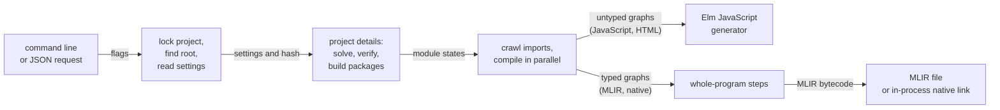

# The build driver

The build driver is the Elm code inside the compiler that takes a project on disk to a finished compile. It locks the project, finds its root, reads the settings, and loads or rebuilds the project details: the solved package dependencies, the built packages, and the recorded state of every local module. It then follows imports from the entry modules and compiles the modules in parallel, reusing a module's cached result unless its source file has changed or a module it imports has a changed interface. The output format, chosen once for the build, decides which compiled form every module and package is built in and what happens next. For JavaScript or HTML the driver hands the untyped graphs to the Elm generator. For an MLIR file or a native executable it loads the typed graphs, runs the whole-program steps and writes MLIR, and for a native executable it then lowers and links inside the same process. Everything the driver needs from the host, such as files, processes, network access and the garbage collector, goes through one input and output layer that has the same interface on every host, so the same Elm source runs when built by stock Elm, as JavaScript and as native code. That is what lets the compiler compile itself.

## What the driver owns

The driver decides what has to be rebuilt and leaves how to compile it to the compiler's phases. It owns the project on disk: where the caches are, which of them are still valid, which packages are needed and where they come from. It owns no phase. It calls the per-module compile and the whole-program step list and reimplements neither, so a build and the compiler's tests run the same middle end.

Two facts shape the rest. The driver is Elm code that an earlier build of the compiler compiles, starting from stock Elm, and stock Elm cannot touch files or start processes; that fact shapes the input and output layer. And a self-compile is large enough that cache size and peak memory decide whether it finishes; that fact shapes the cache format and the handoff to the native back end.

## How a build runs



A build reaches the driver through one of two entry points. The command line initializes a project, builds it, installs and removes packages, bumps a package's version and shows the difference between two versions of a package. A second entry point reads JSON requests on standard input so that other tools can embed the compiler. Both parse their input and pass it to the same builder code. Much of the driver's source tree is support code inherited from the Elm toolchain, such as containers, zip handling and pretty printing, and has no design role of its own.

After the entry point, a build passes through three stages in order: project details, crawl and compile, then generation. All three read and write one cache on disk.

### Project details

The project details are the cached record of everything outside the project's own modules: the solved dependency versions, the built packages, and the last known state of each local module. The driver loads them, or regenerates them when they are missing or no longer valid. They stop being valid in two cases. The settings hash differs from the stored one, as [compiler.md](compiler.md) describes. Or the build asks for a different compiled form from the one the details hold: the typed graph for MLIR and native output, or the untyped graph for JavaScript.

A build writes only the form its output needs. Writing both on every build would add input and output that the build never reads back, and at the scale of a self-compile that cost matters. The price is a rule every reuse decision must keep: a cached package or module counts as reusable only if the artifact for the current form exists. Without that check, a cache written by a JavaScript build reaches a native build that finds no typed artifacts, and the build fails with a corrupt cache.

Eco's own library packages, the kernel package and the system package, are not in the public package registry. The driver finds them through a command line option that names a local package directory, and by looking beside the installed compiler. In both cases it treats the directory as read-only: it copies the package into the user's package cache, builds it there, and refreshes the copy when the source's fingerprint changes. The driver does not build in the source directory, because an installed compiler's directory may belong to root and cannot be written. An application can be marked as a kernel application, which lets it contain the kernel JavaScript that normally only kernel packages carry. A project file may name any 0.19 patch release of Elm, because the language is the same across patch releases.

### Crawl and compile

The driver crawls imports outward from the entry modules and starts a task for each module. Each task puts its result into a slot that one task fills and any number of tasks wait on, which the code calls an MVar. Import cycles are reported at the end of the crawl. The compile then runs every module at once: a module waits on the slots of the modules it imports and starts as soon as they are filled, so independent modules compile in parallel without a separate scheduler.

Reuse follows Elm's own scheme, with early cutoff on interfaces. Each module records two times: when it was last compiled, and when its interface, its exported names and types, last changed. A dependency forces a recompile only if its interface changed after this module was last compiled. When a module is recompiled and its interface comes out equal to the cached one, the module keeps its old interface time, so the modules that import it are not rechecked. Editing a function body without changing its type therefore recompiles only that module. The order of the checks is the design:

```text
crawl:
  path, mtime or docs need differ from the recorded state -> changed (parse again)
  otherwise                                               -> cached
check, once the dependencies' results are in:
  any dependency's interface changed after this module was last compiled
                                                          -> recompile
  otherwise:
    cached, and this form's artifact exists (typed or untyped) -> reuse
    cached, but the artifact is missing                        -> recompile
    changed                                                    -> compile
after a compile:
  old interface equals the new one -> unchanged (interface time kept)
  otherwise write the interface    -> changed (interface time = this build)
```

Checked against `compiler/src/Builder/Build.elm`. The source check compares the recorded modification time for any difference, not for a newer time, so restoring an older file still forces a parse. The "docs need" is whether the build needs the module's documentation. The artifact check is the rule from the previous section, applied per module.

Only the per-module half is incremental. Monomorphization, global optimization and code generation each need the whole program to be correct, so they run in full on every build. Making them incremental is a design question of its own, and partial reuse of their results does not belong in the module compile.

### Generation

For native output the driver loads every package's typed artifacts, merges the modules compiled in this build with the cached typed graphs it reads back from disk, and runs the whole-program step list to a monomorphic program, then writes MLIR. The step list lives in the compiler, not in the driver, so the tests exercise exactly the steps a build runs. For JavaScript output the driver passes the untyped graphs and the entry points to the Elm generator, and the whole-program steps do not run.

For a native executable the driver writes MLIR bytecode to a temporary file in the build directory and calls the C++ back end inside the same process to lower and link it. Just before that call, the driver asks the runtime for one major collection that returns freed memory to the operating system. Without it a self-compile comes close to exhausting a 15 GB machine: the front end's heap is mostly garbage by then, but the runtime never hands it back. The collection only helps if nothing still points at the dead data, so the driver avoids holding any. The progress channel carries results without their payloads, crawl slots are dropped after their last read, and MLIR is written in batches chained one after another. The collection is requested as a Task. An explicit collection is a point where the mutator synchronizes with the collector, and the rule for explicit collections allows one only from a kernel's Task, at the moment the scheduler runs it, never from the middle of pure code. Measured, collections at the boundaries between front-end phases do not lower the peak, and each costs one to four seconds, so the driver has none.

### The cache on disk

Every cached file for a project lives under one directory in the project root, named after the compiler version. A compiler never reads another version's cache, and a change to the artifact format comes with a version change, so a stale format is recompiled rather than misread. Packages are cached the same way under the user's home directory.

Per module the cache holds an interface file and one compiled graph, untyped or typed. The typed graph is the larger. Stored naively it would dominate a cold front-end run, mostly because the same types repeat throughout a module, so each typed file stores every distinct string and type once, in tables at the head of the file ([front-end.md](front-end.md) describes the format). A typed file also holds less than the graph in memory: fields that can be rebuilt are dropped, and come back as inert defaults on load.

Writes go to a temporary file that is then renamed into place, so a crash or a concurrent reader never sees half a file. Each build holds an exclusive lock on its cache directory. Builds that run side by side, such as the end-to-end tests, would otherwise race on the shared cache files, so an option gives each build its own subdirectory with its own lock. Another option runs a one-shot build that writes no cache at all.

## Three hosts, one source

The compiler runs on three hosts. Stock Elm builds it first, and that build runs under Node. The compiler then builds itself as JavaScript with Eco's own kernels, and finally as native code. Fixed-point checks between the stages compare what successive compilers produce, so all three must behave alike.

Every host facility is therefore one Elm module in a family that covers files, processes, the console, the environment, HTTP, MVars, the garbage collector, hashing and the native back end. Each module exists twice with the same exports. One version is a kernel module with JavaScript and C++ implementations, used when Eco compiles the compiler. The other is plain Elm, used when stock Elm compiles it. Stock Elm cannot touch the host, so this version sends each operation as an HTTP request to a local endpoint. A Node handler answers the requests, and a small loader stands in for the browser's request object and starts the compiled compiler. A build picks one version or the other through its source directories, which is why the compiler has two build roots, one for the stock-Elm build and one for the kernel build.

The handler mirrors the kernel modules' behavior, and that mirroring is the contract between the two versions. A failure crosses the boundary as a neutral triple of a tag, a path and a message, and the handler reports it with an error status and a JSON body. A structured error record will not work there: the compiler decides how records are laid out, so neither the handler nor kernel code can build one that matches.

The compiler's version is stamped into a file generated in the build tree from a checked-in baseline, so configuring a build never rewrites a tracked source file.

## Changing the build driver

A change fits when the driver still decides what to rebuild while the phases decide how, every host facility stays behind the paired modules, and every cache stays keyed so that a stale file is recompiled and never trusted. Driver changes must leave the emitted output byte-identical; plans for driver work state that as their gate. The self-compilation chain's fixed-point checks catch the most dangerous way to break it, a driver that makes output depend on the host or on the run.

### Examples of changes that fit the theory
- A command line option is threaded from the build command's flags to the build or generation code that reads it. Separate build directories, one-shot builds, the settings file and local packages all take this route.
- A host operation goes into the kernel module, its plain-Elm twin and the Node handler in one change, with failures reported as the neutral triple.
- A bundled package joins the list the driver probes beside the installation, and the install rules. The system package has this shape.
- A change to the typed artifact format bumps the format version and updates the artifact rules, and old caches recompile.
- A tunable value extends the settings record and contributes to the hash only if it changes generated artifacts.
- A more precise error goes through the driver's reporting module, so every command reports it the same way.

### Examples of changes that would break the theory
- Calling a host facility directly from compiler code, instead of through a paired module, leaves the stock-Elm build with no way to perform it, so the self-compilation chain cannot start. Add the operation to the module family and its twin.
- Building a cache path by hand, instead of through the driver's path helpers for the current build directory, makes side-by-side builds share and corrupt one cache. Use the helpers.
- Reusing a cached module or package without checking that the artifact for the current form exists lets a JavaScript build's cache reach the native path. Keep the check in every reuse decision.
- A setting that changes artifacts but stays out of the hash leaves stale caches, and an unrelated setting in the hash forces cold builds. Decide the setting's hash contribution when it is added.
- Holding whole graphs in closures, channels or MVars across the handoff to the back end means the collection before linking frees nothing. Drop references at their last use.
- Making compiler code branch on what a collection reports. The report's times and memory figures are observations that vary from run to run, and the rule for explicit collections forbids Elm control flow from reading them. Output that depended on them could differ between runs, which the bootstrap's byte-for-byte fixed-point checks would reject. Treat the report as diagnostics only.
- Adding reuse of whole-program results inside the module build gives wrong programs, because those phases need the whole program. Treat incremental whole-program phases as their own design.

## References

Parent: [compiler.md](compiler.md).

Code:

- `compiler/src/Terminal/Main.elm`, `compiler/src/Terminal/Make.elm`: the command line, flags, output dispatch and the native handoff through `Eco.NativeDriver.lowerAndLink`. `compiler/src/API/Main.elm`: the JSON entry point.
- `compiler/src/Builder/Elm/Details.elm`: project details, dependency solving, package builds and cache validity (`needsTypedOpt`).
- `compiler/src/Builder/Build.elm`: crawl (`crawlWithTime`), parallel compile, the reuse checks (`checkDepsHelp`, `handleCachedWithArtifactCheck`), early cutoff (`RSame`, `RNew`), `fromExposed`, `fromPaths`, `OneShot`.
- `compiler/src/Builder/Generate.elm`: typed artifact loading, the call into `Compiler.Pipeline.Steps`, streaming MLIR output, and the JavaScript drivers.
- `compiler/src/Builder/Stuff.elm`: `eco-stuff/<version>` paths, the `*WithBuildDir` helpers, `withRootLockBuildDir`, `writeBytesAtomic`, `bundledPackages`. Per-module files `.eci` (interface), `.eco` (untyped), `.ecot` (typed); package files `artifacts.dat` and `typed-artifacts.dat` under `~/.eco/<version>/packages/`.
- `compiler/src/Builder/Eco/Config.elm`: reads `eco-config.json` and the developer environment overrides. `compiler/src/Builder/GcPoints.elm`: `preLink` and `Eco.GC.majorGC`.
- `compiler/src/Builder/Reporting/Exit.elm`: error reports.
- `compiler/src-xhr/Eco/XHR.elm` and the other `compiler/src-xhr/Eco/*` modules: the plain-Elm twins. `compiler/bin/eco-io-handler.js`, `compiler/bin/index.js`, `compiler/bin/eco-boot-runner.js`: the Node handler and loaders. The kernel twins are in `eco-kernel-cpp/`.
- `compiler/src-version/`: the version baseline. `compiler/CMakeLists.txt`: the self-compilation stages and the `build-xhr` and `build-kernel` roots.
- Options: `--builddir`, `--no-cache`, `--config`, `--local-package`, `--kernel-package`.

Documents:

- `design_docs/incremental-builds/`: the incremental scheme and its limits.
- `compiler/README.md`: covers the compile phases but not the builder, caches or host layer.

Invariants (`design_docs/invariants.csv`): IO_ERR_001, IO_ERR_002, FORBID_IO_001 (host input and output), ECOT_001 to ECOT_003 (typed artifact format), GC_DET_001 and HEAP_076 (explicit collection).
