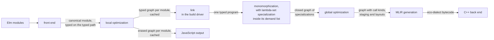

# The compiler

Eco's compiler turns Elm source into eco-dialect MLIR in two halves with a cache between them. The first half compiles each module on its own. It parses the module, resolves names, type checks it while recording the type of every expression, runs Elm's pattern checks and applies the optimizations that need no concrete types, and the build caches the result as one typed graph per module. The second half links the cached graphs into one typed program rooted at `main` and runs a fixed list of pure whole-program steps over it. It specializes every function to the concrete types it is used at, working out along the way which functions can reach each call. It then inlines, removes the specializations nothing reaches any more, settles how every call is made, and writes the result out as MLIR bytecode for the C++ back end. The first half never reads the compiler's settings, and the second half is the same list of functions whether the build or the test suite calls it. When the output is JavaScript or HTML, the whole build takes an erased path instead: the same parser, name resolution and type checker, followed by Elm's own type-free optimizer and JavaScript generator.

## Compute each fact once, where it can be computed

Each fact the back end needs is computed once, in the half and at the step that can compute it, and is passed forward as data. Facts about one module, such as the types of its expressions, belong to the per-module half. That half depends only on the module's source and the interfaces of its imports, so the cache can reuse its output from build to build. Facts about the whole program, such as the concrete types a function is used at, the functions that can reach a call, and how each call is made, belong to the whole-program half, which runs once per build. Later steps read these facts and do not derive them again. The C++ passes follow the same rule one boundary further on, where they read the compiler's decisions as attributes on the dialect's operations.

Two properties of Elm make the whole-program half safe. Elm has no side effects, so inlining a function, deleting unreachable code or copying a function for a concrete type changes nothing a program can observe. And the whole program is known, so the second half can start from `main`, or from a named entry in a test, and see every use of every function.

## The eight parts

Eight parts make up the compiler. The first six are the typed path, in the order a program passes through them. The seventh is the erased path's generator, and the eighth is the driver that runs all of them over a project. One fast path inside MLIR generation, for Bytes encoders and decoders, has a document of its own.



A build uses only one of the two arrows out of local optimization: the typed one for MLIR and native code, the erased one for JavaScript and HTML.

The front end turns Elm source into a typed, canonical program. It is Elm's own parser, name resolution, type checker and pattern checks, kept faithful to Elm's error messages, with one addition. The type checker records the solved type of every expression and pattern by a number given to each expression, then repairs and normalizes those types so that the whole-program phases can work from types instead of syntax. Everything it produces is plain data that can be serialized, because later builds reload typed code from disk instead of checking it again. See [front-end.md](front-end.md).

Local optimization is what Eco does before it knows concrete types. It rewrites each module on its own and keeps every expression's type and solver variable: patterns become decision trees, tail calls and ports are made explicit, and a few cheap rewrites of syntactic sugar are applied. Anything that needs the whole program or concrete types waits for the second half. The erased path's optimizer, Elm's original, which drops types, lives beside it. See [local-optimization.md](local-optimization.md).

Monomorphization specializes every polymorphic function to the concrete types it is used at, so that the back end can choose unboxed layouts and direct calls. Starting from `main`, it works through a list of demands and builds a closed graph with one entry for each global at each concrete type it is used at. Each demand is typed by the type checker's own unifier, so specialization follows exactly the rules that type checking used. Elm's `number` type stays open through specialization and is closed to Int by the prune at the end of monomorphization. Staging, layout and calling conventions are left to the parts after it. See [monomorphization.md](monomorphization.md).

Lambda-set specialization works out which functions can reach each call. It is not a pass of its own: its work happens inside monomorphization's demand list. Every function arrow in the unifier's store carries a set of the functions that can flow there, and when unification merges two types it also joins their sets, so the sets travel with the types. A definition's body is summarized once, as a memoized signature, and only definitions that some demand reaches are summarized. The published algorithm runs two passes instead: whole-program inference bottom-up in dependency order, then a separate specialization pass top-down from the entry point. Folding both into monomorphization's demand list reuses its solver and its worklist and never analyzes dead code. The cost is that a set is a fixed fact as soon as it is computed. Whatever a definition cannot know about its callers becomes "any function" (written ⊤) or "unknown", never a parameter its callers fill in. Specializations are keyed by these sets as well as by types, and global optimization reads them to prove calls direct. The analysis has its own document because it has its own rules, costs and facts about kernel functions, though its code runs inside monomorphization's loop. See [lambda-set-specialization.md](lambda-set-specialization.md).

Global optimization settles how every call is made, once the whole program is specialized. It inlines, regroups each closure to the number of parameters it really takes, marks a call direct only where the lambda sets prove a single callee, and records the kind of every call so that MLIR generation never guesses. Anything it cannot prove stays a generic call. Two rewrites that run before monomorphization also belong to it: alias forwarding, which gets the effect of inlining simple wrappers without copying their bodies, and eta-expansion of each function to its declared arity. Both let more calls be proved direct. Common subexpression elimination, hoisting and deduplication of top-level constants, arity raising, a `List.map` template and borrow inference exist but are off by default, because measurement shows they do not pay. See [global-optimization.md](global-optimization.md).

MLIR generation writes the finished graph out in the eco dialect. It walks the graph one specialization at a time and inserts boxing only where two representations meet: the ABI form at a call boundary, the SSA form inside a function, and the heap form in object fields. Staging, call kinds and layouts are all decided upstream, so it only reads them. It streams its output straight into MLIR bytecode. It has no checker of its own; the C++ verifiers check each operation's local facts when the back end loads the bytecode. See [mlir-generation.md](mlir-generation.md).

Bytes fusion is that fast path. When MLIR generation meets a call to `Bytes.Encode.encode` or `Bytes.Decode.decode` whose encoder or decoder has a shape it can read from the inlined tree, it compiles that shape into direct reads and writes through a buffer cursor, in a small dialect of its own: one buffer of exactly the right size for an encoder, and a bounds check before every read for a decoder. An encoder subtree it cannot read is built as an ordinary encoder value and written into the same buffer by the C++ kernel's own walker. When nothing can be read, or a decoder cannot be read whole, the call stays a plain kernel call, which is always correct because the kernel is the reference for what elm/bytes means. See [bytes-fusion.md](bytes-fusion.md).

JavaScript output keeps the original Elm generator for JavaScript and HTML. The compiler is itself an Elm program that has to run as JavaScript before any native binary exists, and JavaScript is the reference for how an Elm program behaves. The generator sits behind a small interface and is fed the erased graph, so it stays independent of the typed pipeline. See [javascript-output.md](javascript-output.md).

The build driver is the Elm-written code that runs the pipeline over a project. It finds the project, resolves and builds dependencies, compiles modules in parallel from an on-disk cache keyed by timestamps and interface equality, links the cached graphs into one program, chooses the path, and runs the whole-program steps. Everything it needs from the host, such as files, processes and network access, goes through one replaceable input and output layer, so the same source builds with stock Elm and runs both as JavaScript and as native code. That is what lets the compiler compile itself. See [build-driver.md](build-driver.md).

## Typed or erased, chosen once per build

Specialization needs the types that checking finds, and Elm's optimizer throws them away. Eco therefore keeps a typed form of the optimized program beside Elm's erased form instead of changing the erased one, so JavaScript output stays exactly what Elm produces. Eco does not erase types and recover them later; the typed form is carried from the type checker onward.

The output format chooses the path. MLIR and native outputs take the typed path, and every module and every package of that build is compiled by the typed per-module driver. JavaScript and HTML take the erased path, and so do the REPL and documentation generation.

No output needs both forms, so a build produces only one. The cached project details record which form they hold and are rebuilt when a build asks for the other. Without that record, a native build that reused a JavaScript build's cache would reach monomorphization missing the union types it needs. For the same reason the typed path does not run the erased optimizer: nothing on the typed path reads its output, and the typed optimizer reports the same errors about `main`.

One fact does survive in the erased slot on the typed path: a marker saying whether the module defines `main`. The build decides which modules are entry points before generation. When the compiler runs as JavaScript, freshly compiled modules pass between the build's concurrent tasks in serialized form, and the typed graph's serialized form does not carry `main`. So the typed path stores an otherwise empty erased graph whose only content is that marker.

## One type checker, two modes

Both paths use one constraint generator. In typed mode it records which solver variable belongs to each expression, and it creates some extra variables to have one to record. Those extra variables change no result, so the erased mode can run the same generator, extra variables included, with recording switched off. Keeping two near-identical generators fails because copies drift: two such copies report the same record-update error at different places in the source.

## Types are read back, not inferred again

Name resolution gives every expression a number, the constraint variables carry those numbers, and after solving the compiler reads each expression's type from a table by its number. Joining types back onto the program is therefore a table lookup, and a missing type is a compiler bug that crashes the compiler rather than an error shown to the user.

The typed per-module driver does a little more work than the erased one to make those tables complete and stable. After solving, it normalizes every solver variable to its representative, then fills in the types the solver leaves unconstrained, such as those of literals and kernel functions. It then stamps every function type with the solver variable it came from, joins the types onto the canonical program, runs the pattern checks, and runs the typed optimizer.

The stamping always happens, in the per-module half, because that is the last point where the solver's state exists. The stamp travels inside the type into the cached artifact, where monomorphization reads it. Stamping only when a monomorphization setting asks would make the cached file format depend on that setting.

## Nothing cached per module depends on a setting

The rule behind the stamping applies to every setting: nothing cached per module depends on a whole-program setting. Only monomorphization and the steps after it read the settings, and nothing that late is cached per module. One hash of the settings is therefore enough as a cache key. It is stored with the project details, and a mismatch rebuilds them. The key is coarse but correct, and finer keys do not exist.

The settings are one pure record of grouped values, with defaults and an optional JSON file whose keys override them. Keeping the record pure lets passes and code generation import it without breaking the layer order. Reading the file and the environment overrides happens in the build driver, which passes the values in. Each setting either changes generated code, and contributes to the hash, or changes only reports, and does not, so turning on a report keeps the cache.

## One step list for the build and the tests

The whole-program half is a list of pure functions in build order:

1. give every variable in the linked typed graph an id;
2. the pre-monomorphization rewrites (alias forwarding and eta-expansion);
3. monomorphization, with the lambda-set analysis inside it;
4. the post-monomorphization inliner, then the prune, which removes the specializations inlining left unreachable;
5. global optimization.

The build and the compiler's test harnesses call the same functions. A harness with a pipeline of its own drifts: one that picks a different engine, skips the pre-monomorphization rewrites and the prune, or generates MLIR without production's tables ends up checking MLIR that production never emits. A script that runs first in the compiler test target fails if either harness imports a pass module directly. The steps read no environment and write nothing, because that purity is what lets both callers share them; the caller builds reports from the metrics the steps return.

Validators sit between the steps. Each tests a property of the intermediate program and returns either success or a message, and both the build and the tests run them. The steps module also has one function that composes the whole list with its validators, and it is the shortest exact statement of the order:

```elm
toGlobalOpt ecoConfig globalTypeEnv typedGraph =
    let
        pre =
            preMono ecoConfig (prepare ecoConfig typedGraph)
    in
    checkMinted ecoConfig pre.assigned
        |> Result.andThen (\_ -> monomorphize ecoConfig globalTypeEnv pre.assigned)
        |> Result.andThen (\( g, _ ) -> checkStageArity g)
        |> Result.andThen (checkLayout ecoConfig)
        |> Result.andThen
            (\monoGraph ->
                let
                    simplified =
                        prune ecoConfig (Tuple.first (inline ecoConfig monoGraph))
                in
                checkPruned ecoConfig simplified
                    |> Result.andThen (\_ -> checkStageArity (Tuple.first (globalOpt ecoConfig simplified)))
                    |> Result.andThen (checkClosureStaging ecoConfig)
                    ...
            )
```

From `compiler/src/Compiler/Pipeline/Steps.elm`, `toGlobalOpt`. Every step is a pure function of the settings and a graph. The stage arity check, which fails the build when a closure's parameters and captured values do not fit in one closure stage, runs twice. The first run, after monomorphization, catches specialization multiplying a closure's captured functions. Inlining and global optimization decline any rewrite that would break the limit, so a failure in the second run, after them, is a compiler bug. The closure staging check, which compares each closure's parameters with its type's first stage, runs once at the end, and only when validation is on. Neither the build nor the harnesses call this composed function; they call the same steps one at a time, in this order.

The build calls the steps one at a time so that each phase's data can be dropped before the one collection that releases memory ahead of the native back end ([build-driver.md](build-driver.md) gives the measurement behind that single collection).

## Switches are removed once settled

A setting is a boundary that both sides of it must respect, so two mechanisms that walk the same structure cannot share one traversal while each stays switchable. Once measurement settles a setting's value, the setting and the code it guarded are deleted together, gated on byte-identical output over a fixed set of programs. Switches that are off by default and kept "to keep options open" go the same way. The lambda-set analysis is the main place this rule applies. Its settling steps have no switches, so nothing prevents them from sharing one walk, but they run as five separate walks over the same table, in an order that matters, because later walks read or extend what earlier ones wrote.

The choice of monomorphization engine stays a setting for a reason that measurement cannot remove. A second, lighter engine remains because the self-compilation chain needs it. When the compiler compiles itself while running as JavaScript, the default engine with lambda sets comes close to the JavaScript engine's heap limit, so that stage uses the lighter engine. Its output only has to be a correct native compiler, which then compiles the compiler again with the default engine. A third setting runs both engines and compares their output, so the two can be checked against each other.

## Later phases may use earlier ones

The compiler's source tree is divided into nine layers that follow the phase order. They are the syntax trees and the parser; then name resolution, type checking and the pattern checks; then local optimization, monomorphization and global optimization; and last, generation. A module may import modules in its own layer or earlier ones, never later ones, and a code review rule enforces this. When two phases need the same code, it moves down to the earliest phase that uses it. The table that says which kernel calls MLIR generation lowers to inline operations, for example, lives in global optimization rather than in MLIR generation, because the inliner in global optimization also reads it to price those calls. The syntax tree modules hold only types, accessors, serialization and ordering, and the algorithms that work on them live in the phase that runs them.

Modules outside the nine named layers are never checked and may be imported from anywhere. They include the pipeline driver, the settings, the typed join, the graph code, and also the `Data`, `Elm`, `Reporting`, `Json` and `MonoSolver` directories. They escape the check but not the principle. `MonoSolver` holds monomorphization code, and one of its modules imports global optimization's kernel facts, which the rule would forbid inside the monomorphization layer.

## Compiler code must also run as JavaScript

The self-compilation chain runs the compiler under Node, so the JavaScript engine's stack and heap limits apply to compiler code. Recursion that grows with the size of the program overflows the stack on the call graph of thousands of specializations. The compiler therefore has its own graph module, which finds strongly connected components with explicit work stacks over an array-indexed graph, and the build, name resolution, both inliners, the prune and borrow inference use it. The standard Elm graph library recurses in proportion to graph size, so the compiler does not use it. For the same reason the constraint generator walks every chain whose length grows with the program, such as a chain of `let` bindings or of operators, in a self-tail-recursive loop that Elm compiles to a plain loop ([front-end.md](front-end.md)).

Immutability holds for the compiler's own code as well as for the programs it compiles. The compiler keeps its stores in immutable arrays even where a mutable store would compile faster, because Elm code must never observe mutation, and a mutable store depends on a usage contract the compiler cannot check.

## Where a change belongs

A change fits when it computes its fact in the half and at the step that can compute it once, keeps the per-module half independent of settings, and reaches both the build and the tests through the shared step list.

### Examples of changes that fit the theory
- A whole-program pass is a function in the step list at its place in the order, a setting whose hash contribution is decided, and a separate build step that calls it. The tests pick it up through the step list with no further work. Alias forwarding, eta-expansion, common subexpression elimination, deduplication and hoisting each have this shape.
- A validator returns success or a message, runs when validation is on, and is called by both the build and the tests, so a broken property stops either one at the same step. The prune and closure-staging checks are examples.
- A tunable value extends the right group of the settings record, its decoder and its default, and contributes to the hash if it can change generated code. The decoder applies its fields by position, so keep their order equal to the record's parameter order. A switch for the collection before the back end changes no generated code and has no hash token; the constant-thunk setting changes generated code and has one.
- Retiring a setting whose value is settled deletes the setting and the code it guarded in one change, gated on byte-identical output, so the deletion is provably a no-op.
- A per-module fact the typed back end needs is computed in the typed per-module driver while the solver's state exists, carried in the cached typed artifact and its file format, and kept independent of settings. The function-type stamping and the per-file type table follow this pattern.
- A phase directory goes into the layer list when it is created, so the direction of its dependencies is enforced from the start.

### Examples of changes that would break the theory
- Calling passes directly from a test or another driver instead of through the step list. The pipelines drift, and tests check output production never emits. Add the step to the step list and call it from there; the guard script already rejects direct calls from the two harnesses.
- Reading the environment or doing input and output in the settings record or the step list. That breaks the purity that lets the build and the tests share them. Read the value in the build driver and pass it in through the settings. One census in the per-module driver already reads the environment; it is an exception, not a pattern to copy.
- Making per-module compilation depend on a setting. A cached typed artifact that varied with a setting would need cache keys finer than the one settings hash, and those do not exist, so builds would reuse stale artifacts. Compute anything setting-dependent in the whole-program half.
- Running the erased optimizer on the typed path, or feeding JavaScript generation from the typed program. The forms are exclusive per build, and the erased path stays identical to Elm's so that it can serve as the bootstrap's reference. Put typed work on the typed path and leave the erased path alone.
- A setting and the hash out of step. A setting that changes output without contributing to the hash leaves stale caches, and one that changes only a report but contributes causes needless rebuilds. Decide the token when the setting is added.
- A switch that is off by default with no measurement behind it. It splits a traversal that would otherwise be shared, and nothing exercises its other side. Measure first, and ship the mechanism on or not at all.
- An earlier layer importing a later one, or an exemption from the layer rule. Either one lets an early phase depend on a decision made later. Move the shared definitions down to the earliest layer that uses them, as the type-variable helpers and the table of inline kernel operations are. Treat the unchecked directories as if the rule covered them.
- Phase algorithms in the syntax tree modules. Every layer imports those modules, so an algorithm there hides which phase owns it. Put it in the phase that runs it, as graph assembly, the specialization registry and the typed join are.
- Recursion that grows with program size, use of the standard graph library, or a mutable store that Elm code can observe. The first two overflow the JavaScript stack during self-compilation, and the third breaks the guarantee the compiler itself relies on. Use explicit work stacks, the compiler's own graph module and immutable arrays.

## References

Parent: [eco.md](../../../THEORY.md).

Children: [front-end.md](front-end.md), [local-optimization.md](local-optimization.md), [monomorphization.md](monomorphization.md), [lambda-set-specialization.md](lambda-set-specialization.md), [global-optimization.md](global-optimization.md), [mlir-generation.md](mlir-generation.md), [bytes-fusion.md](bytes-fusion.md), [javascript-output.md](javascript-output.md), [build-driver.md](build-driver.md).

Code:

- `compiler/src/Compiler/Compile.elm`: the per-module driver, `compile` for the erased path and `compileTyped` for the typed path, including root normalization, PostSolve, the arrow-root stamping (`SolverRoots.stampArrowRoots`) and the erased stub (`Opt.typedPathStub`).
- `compiler/src/Compiler/Type/Constrain/Erased/Module.elm`: the erased entry point, a wrapper that runs the typed constraint generator with recording off.
- `compiler/src/Compiler/TypedCanonical/Build.elm`, `compiler/src/Compiler/AST/TypedCanonical.elm`: the join of solved types onto the canonical program by node id.
- `compiler/src/Compiler/Pipeline/Steps.elm`: the step list (`prepare`, `preMono`, `monomorphize`, `inline`, `prune`, `globalOpt`), the validators (`checkMinted`, `checkStageArity`, `checkLayout`, `checkPruned`, `checkClosureStaging`) and `toGlobalOpt`.
- `compiler/src/Compiler/Eco/Config.elm`: the `EcoConfig` record, `default`, the `eco-config.json` decoder and `hash`. `compiler/src/Builder/Eco/Config.elm` reads the file and the `ECO_*` environment overrides.
- `compiler/src/Terminal/Make.elm` (`shouldUseTypedOpt`, `graphHasMain`), `compiler/src/Builder/Generate.elm` (`buildMonoGraphFromMerged`, `monoPipelineFrom`), `compiler/src/Builder/Elm/Details.elm` (`hasTypedOpt`, `configChanged`): the choice of path, the running of the steps and the cache checks.
- `compiler/src/Compiler/Graph.elm`: stack-safe strongly connected components.
- `compiler/review/src/ReviewConfig.elm`, `compiler/review/src/EnforceBoundaries.elm`: the layer order and its enforcement.
- `test/scripts/check-test-pipeline-production.sh`: the guard that keeps the harnesses (`tests/TestLogic/TestPipeline.elm`, `tests/Compiler/PackageCompilation.elm`) on the shared step list.
- `compiler/CMakeLists.txt`: the self-compilation stage that pins `ECO_MONO_ENGINE=subst`.
- `compiler/libraries/test`, `compiler/examples`, `compiler/ess.py`, `compiler/find_single_constructors.py`, `compiler/STYLE.md`: a vendored copy of node-test-runner, sample programs, two analysis scripts, and the Elm style guide. `compiler/recomment-bugs.txt` lists suspected bugs that nobody has verified.

Documents:

- `compiler/README.md`: describes a single optimize phase and an `Optimize/` directory that do not exist. The code has `LocalOpt/`, `Monomorphize/`, `MonoSolver/` and `GlobalOpt/`, and the MLIR generator is in `Generate/MLIR/`.

Invariants (`design_docs/invariants.csv`), checked between the steps:

- HEAP_078: staging arity (`checkStageArity`).
- MONO_029: layouts; unconstrained type variables are boxed (`checkLayout`).
- MONO_011: no unreachable specializations after the prune (`checkPruned`).
- GOPT_001: closure staging after global optimization (`checkClosureStaging`).
