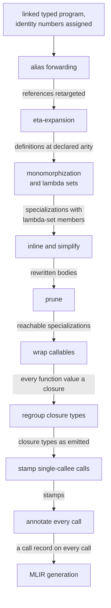

# Global optimization

Once monomorphization has specialized the whole program, global optimization decides how every call is made and writes the decision onto the call, so that MLIR generation reads it instead of working it out. It inlines small functions on their concrete types and removes the specializations that inlining leaves unreachable. It then turns every function-valued top-level definition into a closure, gives each closure a type whose first group of parameters is exactly the parameters the closure takes, marks a call for direct dispatch only where the [lambda sets](lambda-set-specialization.md) prove a single possible callee, and attaches to every call a record of what kind of call it is and how its arguments are grouped. Whatever it cannot prove stays a generic call, which the runtime always applies correctly by reading the closure's header. Two rewrites that run before monomorphization belong here too: forwarding references through simple aliases to their targets, and eta-expanding definitions to the number of parameters their type declares. Both put a visible callee at more call sites, so that more calls can be proved. Common subexpression elimination, hoisting and deduplication of top-level constants, arity raising, a `List.map` template and borrow inference are written but ship off, because measurement shows they do not pay.

## Prove the call, or leave it generic

Elm functions are curried. A function of type `Int -> Int -> Int` can be applied to both arguments at once or to one at a time. Eco calls each group of parameters that a closure takes in one application a stage. The lambda `\x y -> x + y` has one stage of two parameters, while a one-parameter function that returns another lambda has two stages of one. Monomorphization writes every function type in curried form and says nothing about stages. Global optimization chooses them.

Every fact global optimization records must hold for every function value that can reach the call. When it cannot show that, it records nothing stronger than "apply this the generic way". That is always correct, because the runtime can apply any closure from its header, which says how many arguments the closure still needs and how to call it ([closures-and-calls.md](../closures-and-calls.md)). A missed proof therefore costs only speed. A wrong proof is a silent miscompile: the fast paths it licenses load captured values at fixed positions and jump to fixed code with no check at run time. So each pass declines by default and acts only on a narrow license it can check.

Staging is decided in this one phase and nowhere else. When the specializer and the code generator each work out call shapes for themselves, they can disagree, and the code generator ends up guessing arities from the context around a call. With one deciding phase, monomorphization can ignore staging altogether, and MLIR generation only switches on the record it is given.

## The steps, in order

Global optimization is a run of steps in the compiler's shared step list. Two of them run before monomorphization and the rest after it, and each one prepares what the next needs.



The off-by-default passes, when switched on, run after annotation. Checks sit between the steps. When validation is on, they confirm that every copied lambda has fresh identity, that every remaining specialization is reachable, and that closure types are regrouped. One check always runs: every closure's stages must fit the arity limit the runtime's closure header can hold.

## Before monomorphization: a callee at every call site

The two early rewrites serve the step that comes much later. Lambda sets resolve to a single member only where a call site names a concrete lambda or a top-level function. These rewrites make more call sites look like that before specialization starts.

Alias forwarding handles definitions such as `Basics.add`, which has no parameters of its own and only names a kernel, a function implemented in C++. A reference to such an alias becomes the same reference to its target and keeps the caller's metadata. Nothing is copied and no identity is created, so the rewrite cannot damage identity, and the lambda-set analysis then tracks the target itself instead of a wrapper around it. Calls to an alias of a kernel are forwarded only when they pass exactly the kernel's number of arguments, and only when the kernel's calling convention is fixed by its own declared type. A polymorphic kernel takes its convention from the type at each use, so forwarding to it would register one C++ symbol under two conventions. Plain value references to kernel aliases stay as they are.

Eta-expansion gives a definition the parameters its type declares but its code does not write. With `type alias IO a = State -> (State, a)`, a monadic `andThen` written with two parameters has, once the alias is expanded, a type with three, and eta-expansion adds the third. Without it, callers that chain such functions at the alias's arity build partial applications whose results are later applied with no lambda-set member to dispatch on. With it, every site has a lambda literal or a global, and the sets resolve. Expansion moves any work the body does before the added parameters from once per partial application to once per call. A cheapness test therefore limits it to bodies whose work before those parameters is building a value, a partial application, a small saturated call or a kernel that does not allocate.

Every lambda, function arrow and type variable has an identity number before these rewrites run, because the lambda-set analysis keys on those numbers. A pass that copies code must give the copy fresh numbers. A copy that kept them would put two different bodies under one lambda-set member, a silent miscompile. All the early passes therefore take identity from one minting module, `PreMono/Fresh`, and a validation check rejects numbers that are missing or duplicated.

An inliner is also written for this point and ships off. Inlining before specialization does one inline where the later inliner does one per specialization. But alias forwarding covers most of what it would inline, and inlining the rest before specialization leaves slightly more calls generic than inlining it afterward, so the inliner after monomorphization does the work. A pass that would lift closed lambda arguments to the top level stays a count of opportunities and rewrites nothing: the missing lambda-set members it targets are created after monomorphization, by the inliner there.

## Inlining on concrete types, then pruning

The inliner that matters runs on the specialized program, because its most useful rewrites need concrete types. The loop-specializing rewrite copies a tail-recursive higher-order function into a caller that passes it a lambda literal, so the loop calls the lambda directly. Kernel calls are priced from the kernel table, or as a cheap operation when they lower to an inline instruction, and both prices depend on the concrete type.

Candidates are small non-recursive specializations within a cost budget. Functions that call one of their own function parameters get a larger budget, since inlining them is what brings a callback and its call together. Each body is rewritten repeatedly, up to a fixed limit, until it stops changing. The rewrites inline calls that pass the callee all its arguments or more, beta-reduce, forward a let-bound closure that is used once into the call that uses it, merge chains of partial applications, and remove dead bindings and dead closures. A dead kernel call is removed only when the kernel table says dropping it is safe.

Three restrictions protect what later steps rely on.

- A tail-recursive function is never inlined at an ordinary call, because its tail calls must stay inside it to become a loop. The loop-specializing copy is the one exception. It copies the whole function into the caller as a local loop and points the tail calls at that local copy, so they still become a loop.
- Every inlined copy gets fresh lambda numbers and fresh names for its local bindings. Lambda-set identity must stay unique, and the back end rejects a name defined twice.
- A call that passes fewer arguments than the callee takes is not inlined. Inlining it would leave a closure still waiting for arguments, and that closure has no lambda-set member. Keeping the callee's partial application keeps a member that the stamp step can use.

A few `List` functions, such as `reverse`, `append` and `take`, are never inlined. MLIR generation replaces their specializations with kernel code, and that replacement works only on a specialization's own definition, not on a copy pasted into a caller.

Pruning is its own step after the inliner. It collects references again from the rewritten bodies and drops the specializations that inlining orphaned. It cannot live inside the inliner: whether a specialization is dead is a property of the whole program, inlining both removes and adds references, and a callee's body must survive until the inliner has stopped rewriting. This is also the one point where reachability of top-level functions is exact, because the stamp step and constant hoisting add references to specializations later.

## Settling every call

Four phases always run, in a fixed order. Each one establishes what the next reads.

### Every callable becomes a closure

Regrouping, the next phase, needs a parameter list to work from, so a function-typed top-level definition or port value without one is wrapped. A bare reference to a global becomes a closure that calls it, and a kernel becomes a closure with the kernel's flat calling convention. And a partial application aimed directly at a kernel's C++ symbol has no compiled Elm function behind it for MLIR generation to find.

### A closure's type follows its parameters

Every closure and every tail-recursive function gets the type `[its parameters] -> [the rest] -> result`. The first stage is exactly the parameters it takes, and the rest of the curried type follows. Every top-level definition takes the type of its expression. No values are created and no code changes. A closure's own parameter count is the one fact about its staging that holds everywhere, so it is the only fact this phase writes.

Eco has no solver that groups closures into classes, votes on one staging per class and wraps the closures that disagree. Such a solver inserts no wrapper on any measured program. Its graph does not see the branches inlined into a `case`, does not link arguments to parameters, and has little left to reconcile once eta-expansion removes the joins a vote could settle. Without it the output is byte for byte the same.

### One callee, proved

This phase stamps calls and devirtualizes them. Despite its home in `AbiCloning.elm`, it clones nothing. It indexes every closure instance by its lambda-set member and its memory layout. Then, for each call whose callee's lambda set has a single member, it takes one of three outcomes and leaves every other call alone:

- It stamps the call with a representative closure instance, so that code generation can call that closure's fast entry point directly. This needs one source lambda at one layout, the same capture layout in every instance, and identical body fingerprints across the copies.
- When a call passes all its arguments to a local whose single member is a top-level function or constructor without a closure, it turns the call into a direct call of the one specialization that matches. This is devirtualization.
- When the single member is a partial application of a global, it stamps the call for fast dispatch.

The license is strict because a stamp is trusted completely. A stamped call loads captured values at their typed positions and jumps to the representative instance's code without checking which closure it holds. A member the analysis cannot vouch for blocks stamping outright: a synthetic closure adopted from elsewhere, or a lambda member that translation tied to the member already in its specialization's stored demand, to stop specialization from looping ([lambda-set-specialization.md](lambda-set-specialization.md)). The closure instance decides the representation, not the callee's function type, because one function type is shared by flat closures, chains of curried closures and partial applications. Matching on the curried function type at calls that pass extra arguments would decline every callback that takes several arguments.

Devirtualization needs a unique match for the same reason. Monomorphization can split one global into several specializations with the same layout, one per lambda set, and the inliner pastes a different callback into each. Same-layout specializations can therefore compute different functions, and picking any one of them, such as the lowest-numbered, miscompiles.

The phase runs after regrouping so that its stamps describe the closure types that will be emitted. It stays linear on programs with hundreds of thousands of nodes: cheap integer tests come first, instances are bucketed by layout, and only nodes that hold a candidate are rebuilt. Stamping is the last step that reads lambda-set membership, so the member tables are dropped when it finishes. See [lambda-set-specialization.md](lambda-set-specialization.md) for how those members are computed.

### A record on every call

The last phase computes a call record for every call, in one place. MLIR generation reads the record instead of looking up call shapes in its own context. This is the record, from `compiler/src/Compiler/AST/Monomorphized.elm`, trimmed to the fields discussed here:

```elm
type alias CallInfo =
    { callModel : CallModel
    , stageArities : List Int
    ...
    , initialRemaining : Int
    ...
    , closureKind : MaybeClosureKind
    , captureAbi : Maybe CaptureABI
    , fastEvaluator : Maybe LambdaId
    ...
    , callKind : CallKind
    ...
    }
```

Notice the two sources. The stage fields and the call kind come from this phase. The closure kind, capture layout and fast evaluator are the stamps from the previous phase, and annotation carries them over when it computes the record. MLIR generation's check of how many arguments a closure still needs reads `initialRemaining`. Monomorphization gives every call a default record that says "generic apply, no stages", so until global optimization proves something, a call is generic.

A call to a kernel, an external function, a constructor or an effect-manager entry point is a flat direct call. Every other call is staged and curried, and its kind depends on what the phase can see of the callee. The first stage's arity comes, where possible, from a producer it can see: a top-level function, a closure bound by `let` or captured, or a tail-recursive definition. The later stages come from the callee's body. Failing that, the arity comes only from the type. The order of the tests is the policy, so the code itself is shown here, from `computeCallInfo` in `MonoGlobalOptimize.elm`:

```elm
callKind =
    case sourceArityInfo of
        FromProducer _ ->
            if isDynamicCallee env func then
                Mono.CallGenericApply

            else if calleeHasPolymorphicReturn env func then
                Mono.CallGenericApply

            else if hasUnknownExcessArgs then
                Mono.CallSegmentationUnknown

            else
                Mono.CallDirectKnownSegmentation

        FromType _ ->
            if isDynamicCallee env func || calleeHasPolymorphicReturn env func then
                Mono.CallGenericApply

            else
                Mono.CallSegmentationUnknown
```

Notice that a known segmentation needs every test to pass, and an arity read only from the type never claims one. Each fallback is a call the runtime can execute from the closure header: with unknown segmentation the runtime splits the arguments by the header, and a generic apply does all of it at run time. A dynamic callee is a function-typed parameter of the enclosing tail-recursive function. These are the only places a whole-program staging analysis would mark dynamic, so a direct test on the callee does that analysis's job. A callee that traces back to a partial application with a polymorphic return is generic too, because what the producer shows does not describe the function that comes back.

A `case` or `if` that produces a closure yields known stages only when every branch, including branches inlined into the decision tree, is a closure with the same stages. Eco does not re-stage branches so that they agree. A join whose branches differ is left to the runtime, which applies it from the closure header.

## One kernel table, and the rule about `Debug`

Every pass that needs to know what a C++ kernel does asks one hand-audited table. Its row for a kernel records the kernel's effects, whether it allocates on the heap, whether it can fail, which arguments are functions, whether two calls can be merged, borrow modes, and its policy for direct calls. Dead-code removal, inlining cost, eta-expansion's cheapness test, devirtualization and the off-by-default passes all read the same row. The table works as a whitelist: a kernel with no row licenses nothing, and an unknown value means "assume the worst". A row that does not match the C++ body is a miscompile, and the table's consistency is only as good as the test that asserts its own consistency check finds no errors.

`Debug` output is observable on the native path, because optimized native builds keep `Debug` calls. No pass may delete, merge or reorder an expression that can reach a `Debug` kernel, directly or through the functions it calls. A purity analysis computes, over all specializations, which ones can reach `Debug`. A pass that deletes, merges or moves code reads that analysis. The `List.map` template adds the higher-order case, where a logging function is captured or passed as an argument.

## Written, measured and off

Six passes after monomorphization are written and ship off. Measurement shows each one does not pay:

| Pass | What measurement shows |
|------|------------------------|
| Common subexpression elimination | Almost nothing can be merged unconditionally, and the analysis itself allocates. |
| Hoisting constants to the top level | Slower, because building small structures in place is already the fast path. |
| Deduplicating identical constants | Few duplicates and no measurable change, because each constant is computed only once anyway. |
| Arity raising, which merges the stages of curried specializations | Fewer closures allocated, but much slower code, with no threshold that helps. |
| A dedicated `List.map` template | Allocations removed, but the cells it removes die young and cheaply, so run time does not change. |
| Borrow inference, an ownership analysis | A large cost in compile time, and nothing in production uses its results. |

These passes show the shape any pass placed after call annotation must have. Hoisting and common subexpression elimination run after annotation and move code verbatim. Re-annotating after a move costs time exponential in the depth of nested `let` expressions, so passes after annotation move code without changing it, which keeps every moved call's record valid. They skip function-typed results, because moving a callee would leave the enclosing call's record describing a shape that is gone. They never merge constructed values, because two NaN Floats in separate cells can be told apart by pointer equality.

Settings whose answer is known are deleted, as the [parent](compiler.md) explains for the whole compiler. That is why the stamp phase's body-fingerprint check and its devirtualization have no switches. Each transform is also preceded by a separate counting pass that sizes its opportunity. The count is kept apart from the transform so that it can check the transform instead of sharing its traversal, and some transforms, such as the closed-argument lifting, never get past the count.

## Where changes go

A change fits when it adds a proof that declines by default, takes identity from the minting module and call records from annotation, and respects the order: copying and reshaping before the stamp phase, verbatim moves only after it.

### Examples of changes that fit the theory
- Another kernel, or better knowledge of one, is a row added or audited in the kernel table. Every pass that reads the table picks it up with no further change.
- Another whole-program pass is a pure function in the step list behind its own setting with a decided hash token. It comes with a counting pass first and a validation check. Its place relative to stamping and annotation follows from whether it copies code or moves it. Common subexpression elimination and the constant passes have this shape.
- Another way to resolve a callee is a further guarded outcome in the stamp phase that declines by default and counts each reason it declines. Devirtualization and the partial-application fast stamp have this shape.
- Another call kind or call fact is computed in `computeCallInfo`, carried across re-annotation if the stamp phase sets it, and pinned by a numbered invariant with a completeness check.
- Another arity cleanup before monomorphization takes identity from the minting module and counts the bodies it examines, so its reach can be measured.
- A wider representation, such as a larger closure arity limit, lands as a local guard in each pass that builds closures: the stamp phase, eta-expansion and the inliner.

### Examples of changes that would break the theory
- Making MLIR generation work out stages from types when a call record is wrong. That splits the decision across two phases again. Fix the computation of the record, or what it can see.
- Re-staging the branches of a join, or inserting wrappers so that a join looks known. The runtime already handles the join correctly. Remove the join earlier, through eta-expansion, or leave the call generic.
- Stamping or devirtualizing on layout or type alone. Same-layout candidates can compute different functions, and choosing any one of them is a miscompile. Require a unique match or unanimous fingerprints, and decline otherwise.
- An inlining or copying pass after the stamp phase, or a copy that keeps its identity numbers. Stamps name instances, and a copy that keeps its numbers puts two bodies under one member. Run the pass before monomorphization through the minting module, or before stamping with fresh numbers.
- A local test of whether a kernel is pure inside one pass. It drifts from the audited table, and only the table is checked. Read the kernel table.
- Merging, dropping or moving anything that may reach `Debug`, or sharing constructed values that may hold a Float. Both change what a program observably does. Consult the purity analysis and exclude constructions. Constant hoisting as written checks only direct references to `Debug` kernels, so it needs the transitive check before it can be switched on.
- Switching an off pass on because it looks obviously good. Each one is off on measurement, so measure again first. Adding switches instead of deciding also breaks the theory, because switches split traversals that the passes would otherwise share.

## References

Parent: [compiler.md](compiler.md). Related: [monomorphization.md](monomorphization.md), [lambda-set-specialization.md](lambda-set-specialization.md), [mlir-generation.md](mlir-generation.md).

Code:

- `compiler/src/Compiler/Pipeline/Steps.elm`: the step order (`preMono`, `inline`, `prune`, `globalOpt`, `cse`, `dedupe`, `hoist`) and the validators `checkMinted`, `checkPruned`, `checkClosureStaging` and `checkStageArity`.
- `compiler/src/Compiler/Eco/Config.elm`: `default`, which says what is on.
- `compiler/src/Compiler/GlobalOpt/PreMono/AliasForward.elm`, `PreMono/EtaExpand.elm`, `PreMono/Fresh.elm` (`freshenCopy`, `mintNewNode`, `assertMinted`) and `PreMono/LiftClosedArgs.elm` (a count only): the passes before monomorphization.
- `compiler/src/Compiler/GlobalOpt/InlineSimplify.elm`: the inliner before monomorphization, off.
- `compiler/src/Compiler/GlobalOpt/MonoInlineSimplify.elm`: `optimize`, `initRewriteCtx` (candidates), `tryInlineCall` and `loopify`.
- `compiler/src/Compiler/Monomorphize/Prune.elm`: `pruneAfterInline`.
- `compiler/src/Compiler/GlobalOpt/MonoGlobalOptimize.elm`: `globalOptimizeWithStats`, `wrapTopLevelCallables`, `annotateCallStaging`, `computeCallInfo` and `closureBodyStageArities`.
- `compiler/src/Compiler/GlobalOpt/Staging.elm`: `regroup`.
- `compiler/src/Compiler/GlobalOpt/AbiCloning.elm`: `abiCloningPass`, `stampCall` and `postSettleTarget`.
- `compiler/src/Compiler/AST/Monomorphized.elm`: `CallInfo` and `CallKind`.
- `compiler/src/Compiler/GlobalOpt/KernelFacts.elm`: the kernel table and `validationErrors`.
- `compiler/src/Compiler/GlobalOpt/CsePurity.elm`, `MapTemplate.elm`, `MonoReturnArity.elm` and `ListCombinators.elm`: read-only analyses.
- `compiler/src/Compiler/GlobalOpt/MonoCse.elm`, `CafHoist.elm`, `CafDedupe.elm` and `Borrow.elm`: off by default.
- `compiler/src/Compiler/GlobalOpt/CafCensus.elm`, `CseCensus.elm` and `GenCallCensus.elm`: counting passes.
- `test/elm/src/CombinatorRefIdentityBugTest.elm`: the devirtualization miscompile as a test.

Invariants (`design_docs/invariants.csv`):

- GOPT_001: closure staging after regrouping.
- GOPT_003: a join has known stages only when every branch agrees.
- GOPT_010 to GOPT_016: the fields of the call record.
- LSS_008, LSS_009, LSS_017, LSS_018, LSS_024, LSS_025: the lambda-set facts and licenses the stamp phase reads.
- MONO_029: layouts agree across views of a value.
- CGEN_052, CGEN_060, CGEN_069: the remaining-arity check, the generic fallback, and call records after code motion.
- HEAP_078: the closure arity limit.
- OPT_DEBUG_ORDER_001, FORBID_OPT_003: the `Debug` ordering rule and Float-safe sharing of constants.

Documents: `design_docs/debug-log-ordering-policy.md`, `design_docs/globalopt/borrow-inference-design.md`.
