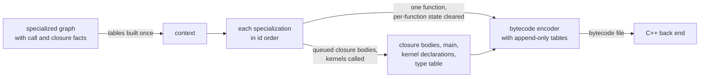

# MLIR generation

MLIR generation takes the finished, fully specialized program graph and writes each specialization out as one function made of eco-dialect operations, in specialization order, streaming each function into MLIR bytecode as soon as it is built. It decides nothing about what the program means. How each call is made, what each closure captures and the shape each constructor has are settled by monomorphization and global optimization and arrive as data on the graph, so code generation only spells them out. Its own job is representation. A value has one form at a call boundary, another inside a function body and a third in a heap object, and code generation tracks the form each operation really produced and converts between forms, by boxing and unboxing, only where two forms meet. It does not verify the module it writes: the dialect's verifiers in the C++ back end check each operation's local facts when the bytecode is loaded, and facts that span operations rest on the numbered invariants.

## Reading decisions, not making them

Every decision that could change behavior is made once, upstream, and carried on the graph. A call carries its call kind and the grouping of its callee's parameters, a closure carries its captures and its kind, and a constructor carries its shape. Code generation reads these facts and never works them out again. If it did, two places would derive the same fact, and when they disagreed the result would be code that only the verifier or LLVM notices, far from the cause. Global optimization already proves these facts, so a second derivation here adds risk and no information. A code review rule backs this up by placing generation last in the compiler's layer order, and the mapping from Elm types to ABI types lives in a module below that layer so that earlier phases can use it too.

That split makes a wrong output easy to place. The fault is either an upstream decision or a conversion at a boundary between representations, and code generation crashes on a mismatch it cannot convert instead of patching it. The function that converts a value to the type a consumer expects shows the rule:

```elm
coerceResultToType ctx var actualTy expectedTy =
    if actualTy == expectedTy then
        ( [], var, ctx )

    else if Types.isEcoValueType expectedTy && not (Types.isEcoValueType actualTy) then
        -- Need primitive -> boxed
        boxToEcoValue ctx var actualTy

    else if Types.isAggValueType expectedTy && Types.isEcoValueType actualTy then
        ...

    else if not (Types.isEcoValueType expectedTy) && Types.isEcoValueType actualTy then
        -- Need boxed -> primitive
        Intrinsics.unboxToType ctx var expectedTy

    else
        ...
        crash <|
            "coerceResultToType: cannot coerce "
```

From `compiler/src/Compiler/Generate/MLIR/Expr.elm`. The only conversions it knows are between a primitive and a boxed eco value, and between a boxed tuple and its value-only form. A 64-bit integer meeting a 64-bit float reaches the final `crash`, because two primitive types that disagree mean monomorphization produced a wrong type, and converting here would hide that.

Code generation does make a few choices about the form of the output, such as emitting a constant's body in place of a call or giving a function a faster calling form. Each changes only what one reference or one function body emits, and none changes what the program computes.

## One pass over the graph

Generation starts by building one context holding every whole-program table the functions need. It contains the signature of every specialization, keyed by the specialization id that monomorphization gave it, along with maps of constant constructors and constant values, the sets of functions chosen for faster calling forms, and the facts global optimization recorded. Building these once lets every function consult them without walking the graph again.



Each specialization then becomes one self-contained function. Before the next one starts, the maps from Elm names to generated values and every per-function cache are cleared. That keeps one function's names out of the next and lets the memory each function used be released while the stream continues.

Four kinds of output can only be written after every function has been seen. Closure bodies are queued while the functions that create the closures are generated, and are emitted after the loop. The entry function `main` follows, with the registration of ports and effect managers that a program performs before it runs. Then comes one declaration for each kernel function the program actually calls (a kernel is a C++ implementation behind Elm's core library), and last a single type table describing the program's types for debugging. These queues grow across the whole loop, so they are the part of the module that streaming cannot release early.

Function names are made safe for the dialect by replacing the characters it does not allow. That replacement can map two different Elm names to the same text, and it drops the package name, so every name ends in `_$_` and its specialization id, which is what keeps names unique.

## Scope fields and counters

The context holds two kinds of state that follow different rules. Scope fields map Elm names to generated values: the variables in scope, the siblings of the let block being generated, the parameters of the closure being built, and other facts keyed by name. Elm names are unique only within one definition, so these fields describe one lexical scope. Counters and accumulators belong to the whole module: the next free SSA number, the queued closures, the kernels called and the type registry. They only grow.

A new function resets the map from names to values, the record of which SSA values are defined, and the SSA numbering together, because each function numbers its values from the start. The remaining per-function caches are cleared between specializations.

Splicing one definition's body into another function needs a different mix, and constant folding (below) does exactly this. The spliced body runs in a fresh lexical scope: every name-keyed field is reset before the body is generated and the caller's fields are restored after it. Without the reset, a folded body that binds `base` inside a caller that also binds `base` would read the caller's value, or would reuse the caller's let-sibling placeholder of the same name. The counters and the set of SSA values already defined keep running, because the spliced values belong to the caller's function and must not reuse numbers it has defined. Last, the result is converted to the ABI return type of the spliced definition, as the definition's own function converts it, so its consumer sees what a call would have returned. A Bool body produces a single bit, and it is boxed because the call would have returned a boxed value. `generateConstThunkRef` in `Expr.elm` is the one place that does all of this, and a test pins the case of two definitions that bind the same let name.

## Three representations and where they meet

A value has three forms in code generation, and they differ on purpose. The ABI form is how a value is passed into and out of a function, held in a closure, or supplied to a partial application. The SSA form is what an operation inside a function body actually produces (SSA, static single assignment, is the style of MLIR's code, in which each value is defined once). The heap form is how a value is stored in a field of an object. Each form, and the rules that link them, are described in [value-representation.md](../value-representation.md); code generation reads those rules and converts between forms where they meet.

Only Int, Float and Char are ever unboxed, that is, held as raw machine numbers rather than as a pointer to a heap object. In the ABI form, Int is a 64-bit integer, Float a 64-bit float and Char a 32-bit integer holding the code point. Every other value, Bool included, is a pointer-sized eco value. Monomorphization closes every open `number` to Int before code generation, and the type mapping treats any that remained as Int. In the heap form the same three types may sit unboxed in a field, and each field has a two-bit kind saying whether it holds a pointer, an Int, a Float or a Char. The order of fields in an object comes from shared layout functions, which [value-representation.md](../value-representation.md) describes, so every object of one type has one layout.

The SSA form is whatever each operation really produced, and code generation carries that type with every value it generates. Conversions happen only where two forms meet: where an argument is passed to a call, where a value is captured into a closure, where a field is stored or read, and where a result must match its declared type. The field kinds written on construction and closure operations are computed from the operands' SSA types, so they always agree with what is stored.

Tracking the real type, rather than working one out from the Elm type at each use, is what keeps those conversions correct. A call result typed from the call site instead of from the callee's registered signature is wrong whenever the two disagree. An alias such as `Task.succeed`, whose underlying parameter is a boxed value, would receive a raw integer, and LLVM aborts on it. So every call site boxes each argument to the parameter types of the function actually called. For partial applications, the verifier's check of added arguments against the target function's parameters makes the next mismatch of that kind fail in MLIR rather than in LLVM; direct calls have no such check.

Bool shows the policy most clearly. Inside a function body a Bool is a single bit, because a bit can drive a branch directly. Heap and closure fields can only tell a pointer from an Int, a Float or a Char, and True and False exist in the runtime as constants embedded in the pointer word. So a Bool is boxed to one of those constants when it is passed to a call, captured or stored, and is unboxed back to a bit when it is read from a field. An `if`, or any branch on a Bool, becomes a case operation whose subject is the bit. Reading a stored Bool directly as a bit is a real bug even though it often gives the right answer: it reads only the low bit of the constant's word, which matches the Bool only because of how the constants are encoded, and under an encoding where True and False share no low bit it inverts every Bool test.

Char is a 32-bit integer in every constant and operation code generation writes. A Char is one Unicode code point, so a character literal or pattern such as `'😀'`, which the front end carries as a surrogate-pair escape, becomes the single constant 128512; the String kernels, not code generation, convert between code points and the UTF-16 units strings are stored in. The dialect's Char type and its character case kind expect that width ([value-representation.md](../value-representation.md)). Ctor tags are also `i32`, but they never reach a slot-kind or boxing decision, which is where `i32` is read as Char.

Objects too wide for the field kinds in their header carry extra kind words after their fields. That raises the limits on closure arity and record width to 2047, far above what real programs need, instead of capping them at what the header alone can describe. A function too wide even for that gets a compile error pointing at its source.

## What each kind of Elm code becomes

Each Elm construct has one translation, and each reads the facts the graph carries rather than computing them.

Constructors become small functions. A constructor with fields becomes a function whose body builds a custom object, with its tag, size and field kinds computed from the constructor's shape in the graph. A constructor with no fields becomes a shared constant, and the core library's True, False and Nothing become the runtime's built-in constants. Where a program refers to such a constructor, code generation emits the constant in place of a call, and the constructor's own function remains for any route that does not use the shortcut. Lists, tuples and records have their own construction operations. Where global optimization or the faster calling forms keep an aggregate as a value passed between functions, code generation emits value-only forms that live in SSA and are written to the heap only when they must be.

A closure that captures variables gets one function, named with a `$cap` suffix, which takes the captures and then the parameters, all with their real types, and does the work. Everything that calls the closure, in generated code and in the runtime, goes through it, and the operation that creates the closure names it both as its function and as its fast evaluator. No second function taking the closure pointer is emitted. How a closure is laid out and applied is described in [closures-and-calls.md](../closures-and-calls.md). A closure that captures nothing gets a single function, which plays the same role, and a closure with no parameters is a plain call. The C++ passes find the capturing closure's function by its `$cap` suffix.

Closures in one let block that refer to each other are allocated together by one group operation. Allocating them one at a time would need placeholders for the siblings not yet built, and those placeholders break SSA's rule that a value is defined before it is used. Allocated together, every sibling's pointer is known before any capture is written.

Calls take one of four forms, chosen by the call kind global optimization recorded. A closure names a target function, which the runtime reaches through the closure's static descriptor once the closure has all its arguments.

| Call kind | Emitted as |
|---|---|
| Kernel or other external function | a direct call |
| Callee's parameter grouping known | a direct call when every argument is supplied, otherwise a partial application that records how many arguments remain |
| Grouping unknown | a partial application with each argument boxed to the evaluator's parameter types |
| Fully generic | a partial application that boxes only Bools and may return an Int, Float or Char unboxed |

Where global optimization has stamped a call site with a single fast target, the stamp takes precedence over the call kind on every path that calls a closure. Inlining can reclassify a site after it is stamped, and without the precedence that site would take the slow path even though its target is known.

Fully generic calls pass Ints, Floats and Chars unboxed because generic calls are common, and boxing each primitive argument would allocate on every one. How the lowering and the runtime box them in one place, only when the evaluator needs it, is described in [closures-and-calls.md](../closures-and-calls.md).

Pattern matches become nested case operations that produce values. Every branch ends by yielding its value, and every branch region is a single block, so that a later C++ pass can turn each case operation into structured control flow. Local optimization lets several arms of a decision tree share one branch as a jump target; code generation copies that branch into each arm instead, which is what keeps every region a single block. A chain of tests checks its first condition and nests the rest inside the success branch, because evaluating the tests side by side would read the head of a list before checking that the list is not empty.

A function that calls itself in tail position, and a local tail-recursive definition, become a while loop whose body is a case operation. Every case branch must end by yielding a value, so a tail call inside a branch cannot be a jump back to the start of the function. Inside the loop, a branch that makes a tail call yields the next arguments, a branch that returns yields its result with a flag saying the loop is done, and the loop decides from the flag whether to run again.

Kernel calls register their types. Each call records the kernel's parameter and result types in the context, worked out from the specialized Elm types of that instance. The first registration of a symbol fixes its types, and a later call that disagrees crashes the compiler instead of quietly changing them, because the lowering must never infer a kernel's types from how it is used. Declarations are written once, after every function, marked as kernels and, where the kernel is known not to allocate, marked so that the back end can skip collector bookkeeping around the call. Per-instance types let operations such as comparison and addition take unboxed numbers where a single boxed policy would box every argument.

## Top-level constants: folded or memoized

A top-level value with no arguments compiles to a function of no arguments, a thunk. Code generation shortens the route to some of them, in one of two ways that apply to different kinds of value.

A thunk whose body is small and closed is folded at each reference. The bodies that qualify are literals other than strings, unit, `pi` and `e`, a chain of aliases to one of those or to a constant constructor, and a closed body of those with lets and pure arithmetic of bounded size. At each reference, code generation emits the thunk's own body in place of the call, under the fresh scope described above, and LLVM does the arithmetic. The thunk's function remains for every other route. Emitting the body gives exactly the semantics of calling it, with the same operations and the same guards. The compiler does not evaluate the body itself, because it may be running under JavaScript, whose 32-bit bitwise operations, math library and float printing differ from native code, so a value computed in the compiler could differ from the one the program computes. Folding in the front end also removes the calls before the back end splits the module, so no whole-module LLVM step is needed to propagate these values.

A thunk computed at run time may instead get a memo slot: a global that holds its value once the first use has computed it, so later uses read the global. Only a thunk whose ABI result is a boxed eco value qualifies. Once the slot is filled the collector treats it as a root and reads the word in it as a heap pointer, so a raw Int, Float or Char in the slot would be read as an address. A slot value of zero means "not yet computed", and no boxed value is zero. The test is short enough to quote:

```elm
cafMemoQualifies ctx expr monoType =
    ctx.ecoConfig.cafMemo.enabled
        && (Types.monoTypeToAbi monoType == Types.ecoValue)
        && (case expr of
                Mono.MonoClosure _ _ _ ->
                    False

                Mono.MonoLiteral _ _ ->
                    False

                Mono.MonoUnit ->
                    False

                _ ->
                    True
           )
```

From `compiler/src/Compiler/Generate/MLIR/Functions.elm`. The test is on the ABI type, so a Bool constant qualifies (its ABI form is boxed) and an Int, Float or Char constant never does. Literal and unit bodies are skipped because the once-only check costs more than the body, and a closure is a function, not a value to compute. Ports are excluded separately: their definitions are generated with memoization turned off. The generator has no other exclusion, and `main` is not treated specially. An Int, Float or Char constant that is not folded is therefore a plain call to its thunk at every use.

## Emitters layered on the core

A handful of specialized emitters sit on top of the core translation, and they share one shape. Each is chosen in code generation, each changes only what one reference or one function body emits, and each leaves the graph as the single source of what the program means. Most can be turned off in the compiler's settings (for byte fusion, only the encoder half), and the original function remains for any route that does not use it.

Five of them replace what a function or reference emits:

- Kernel operations that global optimization marks as intrinsics are emitted as dedicated typed operations.
- Bytes encoders and decoders whose shape can be read are compiled into direct buffer code in a separate dialect, as [bytes-fusion.md](bytes-fusion.md) describes; only the encoder half can be turned off.
- A template for `List.map` emits a dedicated list operation. It ships off.
- Constant folding and memo slots, described above.
- A function that returns or takes a tuple or record gets a worker that returns through memory supplied by the caller or takes the parts as separate parameters, with a small shim keeping the original entry. A worker is chosen only where some call site profits, because without one the worker and shim are pure overhead. Eco has no separate C++ pass that flattens aggregate boundaries, because measurement shows such a pass does not pay; these workers do that job where it profits.

Three more annotate the output instead. Logical type annotations give later passes the Elm-level types of each function's parameters and result, which the ABI form does not show. The debug type table describes the types a program may print, as the next section explains. Name sanitizing and the specialization id suffix were described above.

## The debug type table

A heap object records its tag, its size and the kinds of its fields, but no names. On the native path, `Debug.log` and `Debug.toString` must still print constructor and field names, so the compiler describes each printable type once, in a table emitted with the program, instead of storing type information in every heap object. The printer starts from one type id and walks the static table, using the object's tags and field kinds for the rest. The table also tells apart values the heap cannot: unit, the empty list, `Nothing`, the empty string and the empty record are all the same embedded word, so the printer names them from the type. A program pays only for the types its debugging and construction sites reach.

Types are registered lazily during generation. The first time a registration site meets a type, the type gets the next id, so ids run 0, 1, 2 and so on without gaps. The sites are the argument of a saturated `Debug.log` or `Debug.toString`, list literals, record and tuple creation, and every constructor definition. Each registration also walks the type's nested types with a work list: list and tuple elements, record fields, type arguments, function arguments and results, and constructor fields. A type that refers to itself is not queued again. A type reached from no site gets no id, and a nested type that was never registered would be looked up as id 0 and printed as whatever type 0 is, which is why registration walks every nested type.

The registry is an accumulator, kept from one function to the next, because the runtime expects one dense table for the whole program. After every function, the closure bodies, `main` and the kernel declarations, one end-of-module operation, `eco.type_table`, carries the table as five flat arrays: the type descriptors sorted by id, the fields as pairs of a name and a type id, the constructors, the argument types of functions, and one table of strings without duplicates. Fields are listed by the same layout functions that build the heap objects, so field entry i describes heap slot i, and a record prints in its heap order. The printer indexes the descriptors by id and pairs table field i with heap slot i, so the table must stay dense, sorted and in heap order.

The two debugging functions use the table when code generation knows the argument's type. A saturated `Debug.log label v` becomes a debug-print operation with both values boxed and two type ids, the String's and that of `v`, and its lowering calls a printer that writes `label: value`. A saturated `Debug.toString v` calls a typed kernel function that takes the type id as a second argument. Used as function values, both reach kernels that receive no id and print by heap tag alone, a constructor as `Ctor<n>` and a field as `f<i>`. The typed `Debug.toString` is a separate kernel because a closure call passes only one argument, so a single kernel with a type-id parameter would read an id it was never given.

At startup the runtime registers the table, which the lowering has packed into constant bytes laid out as the structs in `TypeInfo.hpp`. Its printer names embedded constants from the type, prints `<function>` for functions and prints a type variable's value by heap tag. It prints `<internals>` when an object's shape disagrees with the table, because values built by kernels, such as the contents of a `Json.Value`, need not have the shape their Elm type describes, and the JavaScript runtime prints them the same way.

A kind of type is defined in five places that must change together: its constructor and tag in `TypeTable.elm`, with its nested types; the enumerator at the same position in `TypeInfo.hpp`; an arm of the descriptor union there, which must fit the twelve data bytes of a twenty-byte descriptor; a case in the lowering's packing switch; and an arm in the runtime printer. The arrays on the operation are untyped, and no build step or verifier compares the two sides, so a kind added on one side only is packed as nothing and misread at run time. The constraint of a type variable is already packed as nothing this way, which is harmless only because the printer ignores it.

## Writing the bytecode

Each function is encoded into MLIR bytecode as soon as it is built, so the whole module is never in memory at once. The compiler is a garbage-collected Elm program that runs under Node.js during bootstrap and natively once it compiles itself, and holding the whole module in memory, then its text, would make memory peak at code generation. Bytecode allows streaming because function bodies refer to the module's shared tables of strings, types, attributes and operation names only by index. When those tables only grow, an index written early stays valid, so each function can be encoded and dropped. Functions are generated in batches of tasks chained one after another, so graph nodes already written become garbage before the back end starts. The bytecode reaches the C++ back end through a temporary file inside the one `eco` process, and MLIR's reader recognizes bytecode by its first bytes, so the C++ tools need no special handling.

The MLIR model on the Elm side is generic. An operation is a name plus operands, results, attributes and regions, and nothing in the model knows which operations exist, so adding an operation means adding one builder function. The writer uses bytecode version 4, because later versions require a section for operation properties and eco operations use none. Built-in MLIR types and attributes use MLIR's binary encoding, which MLIR fixes and which needs nothing from Eco. The dialect's own types are written as their text, because a binary encoding for them would need support code in the C++ dialect.

Neither the bytecode writer nor the text printer checks anything. A string, type or name missing from the tables is written as an invalid index, which produces a corrupt file rather than an error. Correctness is left to the verifiers, which check local facts: operand types against the types recorded on each operation, field kinds against operand types, partial applications against the function they target, kernel declarations, and that every called function is declared. They do not check direct call signatures in a normal build, so a fact a later pass relies on needs a verifier rule of its own.

A text form exists for debugging, selected by a build option. It is a view of the module, not an equal of the bytecode. It drops source locations, prints NaN and infinities as nothing, rounds some floats in exponent form, and drops the backslash of unknown string escapes, so a numeric problem is investigated on bytecode. Every operation carries an unknown source location in either form, because code generation records none.

The C++ side reads several facts by name or number, and each must stay in step with code generation. The passes find a closure's working function by its `$cap` suffix, the back end derives the same `__eco_caf$` name for a memo slot, the type table's kind numbers must equal the runtime's type kind enums, and the control-flow pass expects case operations in the yield form with single-block regions.

Code generation supplies no garbage collection roots. The back end computes them from pointer liveness in LLVM, so nothing here has to be kept in step with the collector.

## Changing the generator

A change fits when it carries a decision in from upstream, converts representations only where two forms meet, and gives the verifier a rule for any fact a later pass depends on.

### Examples of changes that fit the theory
- A typed operation for a kernel function: one builder, plus an arm in the intrinsic emitter that global optimization's intrinsic selection chooses, using the existing boxing helpers. Typed string comparison, value equality and inline string length have this shape.
- A shortcut map keyed by specialization id: built once in the context, consulted at one shared place such as the reference to a global, and leaving the original function in place. Shared constant constructors and constant folding both work like this.
- A representation fact a later pass needs: stamped at every point that emits the operation and checked by a verifier rule, so a missing stamp fails in MLIR. The unboxed result kind on generic calls, the logical type annotations and the field kinds follow this pattern.
- A structural impossibility fixed by an operation that expresses it rather than by placeholders, as the group allocation of mutually recursive closures does.
- A capacity limit raised with extra kind words, with a located compile error at the remaining limit.
- A kernel, registered with its per-instance types so that its declaration is generated, with no special handling at its call sites.
- Another kind of type, or of primitive, in the debug type table, changed in all five places in one commit. The unit primitive kind has this shape: an Elm-side tag, the matching runtime enumerator and a printer arm that names the shared empty word as `()`.
- Printing another kind of value with its type: register the type where the value is created or printed, as list literals and record creation do, and pass the id as an operand or attribute.

### Examples of changes that would break the theory
- Working out a call kind, parameter grouping, closure kind or layout inside expression generation. It duplicates a fact upstream already proves, and the two will drift. Carry it on the call, closure or constructor shape from global optimization or monomorphization.
- Boxing one kind of argument at one call form because a callee disagrees. The next kind of argument fails the same way. Box to the callee's registered parameter types at every call site, and add a verifier rule so the next mismatch fails in MLIR.
- Reading a stored Bool, or any stored boxed value, directly at the primitive type wanted. That reads part of a pointer and inverts Bool tests. Read the field as an eco value and then unbox it.
- Repairing types in C++ after the fact, or letting the lowering infer a kernel's types from its uses. Both hide the bug that produced the wrong type. Emit the right type and let the verifier reject the wrong one.
- Closing an unfinished branch region with a dummy return or yield, or emitting the low-level allocation operations directly. Both break forms that the C++ passes rely on. End every decision tree path in its yield, and use the construction operations.
- Keeping per-function data in the context without clearing it between functions, or accumulating data across the whole module. Either grows memory across the stream and can leak names from one function into the next. Clear it with the other per-function state.
- Generating one definition's body inside another with the caller's context unchanged, for inlining, folding or a template. Let names in the spliced body then collide with the caller's. The opposite mistake, resetting the SSA counter as for a fresh function, reuses numbers the caller has already defined. Reset and restore every name-keyed field, keep the counters running and convert the result to the callee's ABI, as `generateConstThunkRef` does. A scope field added to the context must join its reset and restore list.
- Giving an Int, Float or Char constant a memo slot. The collector would scan the raw number as a pointer. Fold the constant at its references, or design a slot kind the collector does not scan.
- Evaluating a constant body in the compiler and emitting the result. The value would depend on the host running the compiler. Emit the body and let LLVM fold it.
- Trusting the text form when debugging a numeric problem. It prints some floats and escapes differently. Compare bytecode, or fix the printer.
- A faster calling form with no check that some call site profits, or with no verifier rule behind it. Without the check it is pure overhead, and without the rule a broken promotion reaches LLVM. The worker selections in `Backend.elm` show the required shape.
- Changing a type's heap layout without the table following, for example ordering fields by another function in construction while the table still uses the shared layout function. The printer then pairs names and child types with the wrong slots. Change the shared layout function, which both use.
- Adding or reordering a type kind on one side only. Nothing checks that the two sides agree, so the runtime misreads the descriptor. Change all five places together.
- Merging the typed `Debug.toString` kernel back into the one that closures call, or giving that one a type-id parameter. A closure call passes one argument, so the second would be garbage. Keep typed printing on saturated calls.
- Keeping the type registry per function, by clearing it with the per-function state or emitting a table per batch. Ids would be reused across functions while the runtime expects one dense table for the program. Leave it an accumulator.
- Working around a miscompile of the self-hosted compiler by changing the compiler's own source. The bug stays in code generation for the next program to hit. Fix code generation and pin the case with a test.

## References

Parent: [compiler.md](compiler.md). Related: [bytes-fusion.md](bytes-fusion.md), [value-representation.md](../value-representation.md), [closures-and-calls.md](../closures-and-calls.md).

Code:

- `compiler/src/Compiler/Generate/MLIR/Backend.elm`: entry points (`streamMlirBytecode`, `streamMlirToWriter`, the test-side `generateMlirModule`), `buildContext`, the batched streaming loop, and worker selection (`buildSretPromoted`, `buildPsplitPromoted`).
- `compiler/src/Compiler/Generate/MLIR/Context.elm`: generation state, scope fields and accumulators, kernel registration (`registerKernelInstance`, `insertKernelDecl`).
- `compiler/src/Compiler/Generate/MLIR/Types.elm`, `compiler/src/Compiler/AST/MonoAbi.elm`: the ABI, SSA and heap rules (`monoTypeToAbi`, `canUnbox`, `computeCtorLayout`).
- `compiler/src/Compiler/Generate/MLIR/Expr.elm`: calls (`generateCall`), closures (`generateClosure`), case (`generateCase`), the boxing helpers (`coerceResultToType`, `boxArgsToEvaluatorParams`, `boxArgsForClosureBoundary`) and constant folding at a reference (`generateVarGlobal`, `generateConstThunkRef`).
- `compiler/src/Compiler/Generate/MLIR/Functions.elm` (`generateNode`, `generateDefine`, `generateCtor`, `generateClosureFuncWithClones`, `cafMemoQualifies`), `Lambdas.elm`, `TailRec.elm` (`compileTailFuncToWhile`).
- `compiler/src/Compiler/Generate/MLIR/Ops.elm`, `Patterns.elm`: operation builders, and field access along decision tree paths.
- `compiler/src/Compiler/Generate/MLIR/Intrinsics.elm`, `ConstThunks.elm`, `LogicalTypes.elm`, `TypeTable.elm`, `Names.elm`: the layered emitters.
- `compiler/src/Mlir/Mlir.elm`, `compiler/src/Mlir/Bytecode/StreamEncode.elm`, `compiler/src/Mlir/Bytecode/AttrType.elm`, `compiler/src/Mlir/Pretty.elm`: the generic model, the streaming writer and the text printer (selected by `--text-mlir`, or `ECO_TEXT_MLIR` in the test suite).
- `compiler/src/Compiler/Generate/MLIR/TypeTable.elm` (`generateTypeTable`) and `Context.getOrCreateTypeIdForMonoType`; `runtime/src/allocator/TypeInfo.hpp` (`EcoTypeKind`, `EcoPrimKind`, `EcoTypeInfo`), `TypeTableOpLowering` in `runtime/src/codegen/Passes/EcoToLLVMGlobals.cpp` and `print_typed_value` in `runtime/src/allocator/RuntimeExports.cpp`: the debug type table and the five places a type kind is defined.
- `ConstThunkFoldTest` in the compiler tests: the pinned case of a spliced body that rebinds a caller's let name.
- `runtime/src/codegen/EcoOps.cpp`, `runtime/src/codegen/Ops.td`: the verifiers and operation definitions. `EcoPAPSimplify.cpp`, `CheckEcoClosureCaptures.cpp`, `EcoToLLVMGlobals.cpp`, `EcoControlFlowToSCF` and `TypeInfo.hpp` hold the C++ assumptions listed above.

Documents:

- `design_docs/caf-memoization-design.md`.

Invariants (`design_docs/invariants.csv`):

- Codegen rules: CGEN_001, CGEN_008, CGEN_011, CGEN_014, CGEN_015, CGEN_038, CGEN_039, CGEN_041, CGEN_047, CGEN_048, CGEN_059, CGEN_060, CGEN_064, CGEN_065, CGEN_068, CGEN_080, CGEN_082, CGEN_CLOSURE_004. CGEN_014 names a graph field (`ctorLayouts`) that is `ctorShapes` in the code; CGEN_034, CGEN_056 and CGEN_058 say a generic partial application always returns a boxed value, but an unboxed primitive result is allowed.
- Representation and heap: REP_ABI_001, REP_SSA_001, REP_HEAP_001, REP_HEAP_002, REP_BOUNDARY_001 to REP_BOUNDARY_003, REP_CLOSURE_001, REP_CONSTANT_001, REP_AGG_001, HEAP_019, HEAP_035.
- Kernels and upstream: KERN_006, GOPT_001, GOPT_003.
