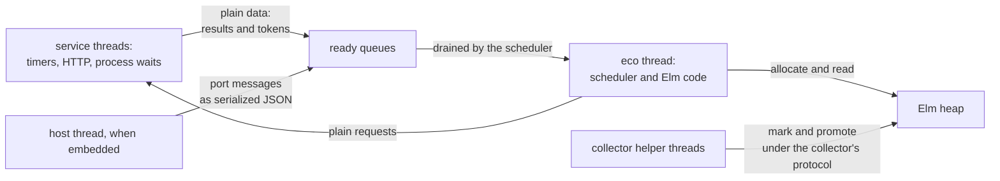

# Runtime

A compiled Eco program runs on a native runtime, written in C++ and linked into every executable, that has two parts. A garbage collector allocates every Elm value and reclaims the ones the program can no longer reach. A scheduler runs Elm's tasks, effect managers, timers, HTTP requests and ports. Both parts are built around one thread that the runtime starts for the program, called the eco thread. It is the only thread that runs Elm code or allocates Elm values, and each process has exactly one. The collector copies young objects that survive, and it needs no write barrier because Elm values never change once the program can see them. Threads that wait on timers, the network or child processes never touch the heap: they hand plain data back to the eco thread, which builds the Elm values.

## The eco thread owns the heap

The thread that runs Elm code and allocates is what a collector calls the mutator. Eco allows one per process, and creating a second live heap aborts the program while the second thread is being set up. With one mutator, the collector has the heap to itself whenever it runs: no other thread is allocating, reading or holding a pointer it has not been told about.

The scheduler is shaped by the same rule. It cannot hand Elm work to another thread, so it is an event loop on the eco thread: it steps one task at a time, and when nothing is ready it waits for an outside event.

The missing write barrier has a different source. It comes from Elm's immutability, as [eco.md](../../../THEORY.md) explains: an old object can never point to a younger one, because the younger one did not exist when the old one was last written. One mutator and immutability are separate facts, and the runtime needs both.

Three designs for threads are easy to confuse, and they have different standing.

| Design | Standing | Why |
|---|---|---|
| One heap, one mutator per process | What the runtime does | The accounting of committed memory, the timing of returning memory to the system, and the list of released address ranges are all process-wide. Making them per heap costs far more than forbidding a second heap, and only benchmark and test harnesses ask for several. Every production entry point creates exactly one heap. |
| One shared heap with many mutators | Rejected | It needs young objects that can point between threads, or stop-the-world young collections with safepoint polls in every loop, a marking handshake with each mutator, and much larger formal models. The JavaScript back end, running on Node workers, cannot offer the same behavior. |
| A heap per thread, each with one mutator, threads exchanging only messages | The decided future direction, not built | It keeps every property the runtime relies on inside each heap. It needs the process-wide accounting above split per heap, which is why it is a project of its own and not a small change. |

Besides the eco thread, the runtime runs two kinds of thread. The collector's helper threads mark the old generation and promote survivors in the background, under a protocol the collector defines and formal models describe. Service threads wait on timers, HTTP and child processes, and they hold only plain data such as deadlines, request structures and resume tokens. A host program that embeds Eco adds a thread of its own, which talks to the eco thread through a queue.

## The collector and the scheduler

The runtime's two parts divide its work: the collector decides how values are stored and when they are reclaimed, and the scheduler decides when Elm code runs. The forms that strings, lists and byte sequences take inside the heap belong to the storage side, and they have a document of their own.

The garbage collector gives each process's single mutator one heap. Young objects are allocated in a nursery by bumping a pointer, and the survivors of a young collection are copied out of it. Old objects live in a separate generation that does not move, in blocks grouped by object size, with a bitmap per block recording which cells are live. It can stay this simple because no published object is written again, so no old object points to a younger one. That removes the write barrier, and it also lets the old generation be marked, and survivors promoted, on helper threads without one. The cost is a discipline that code outside the collector must keep, and a body of protocol code, heap validators and formal models that check the concurrent parts. See [garbage-collector.md](garbage-collector.md).

Inside the heap, strings, lists and byte sequences each have several forms, which the runtime chooses value by value under size thresholds that trade copying against sharing. A String may be a flat array of UTF-16 code units, a large array whose payload is kept apart from its header, a slice of another string, a rope joining two strings, or one of two all-ASCII UTF-8 forms. A List is a chain that can mix single cons cells with views over dense arrays, and Bytes is a flat buffer, a slice of one or a large buffer kept apart from its header. The empty value of all three is one shared constant. Kernels rely only on the content and on the length in the object's header, never on which form they hold, so a new string form, such as a rope or a UTF-8 string, is a change to the runtime and not to the kernels. Compiled code reads list cells inline, so a new list form is also a change to compiled code, and chunked lists are switched on for the whole program or not at all. See [runtime-data-structures.md](data-structures.md).

The scheduler is Elm's own scheduler, implemented again over the Eco heap. The eco thread steps tasks and processes, which are themselves immutable heap values, and calls every effect manager and port synchronously. Timers, HTTP and child-process waits run on service threads that hand back plain tokens, and input from a host program arrives through a queue that the eco thread drains. The program stays alive exactly as long as it holds a counted claim, called a hold, on something it asked for. Running all of Elm on one thread follows from the collector's one-mutator design. See [scheduler-and-services.md](scheduler-and-services.md).

## How compiled code reaches the heap

Compiled code allocates in two ways. At points the compiler marks for it, it bumps the nursery pointer inline, so the commonest allocations cost no call. Every other heap operation, including larger allocations, applying a closure and building lists through a scratch stack, calls a C function the runtime exports.

A heap reference is the object's raw address, aligned to eight bytes. Following it needs no base register, addition or shift, which keeps compiled code short. A few values are never allocated: True, False, one constant shared by Unit, the empty list, Nothing, the empty string and the empty record, and every other constructor with no fields. Each is a small word with a bit set that marks it as a constant rather than an address. The low bit of a Bool word equals the one-bit value the compiler uses for Bool in its intermediate code, so the Bool held in a heap field, passed across a call and used in the intermediate code line up without conversion. Code tells a constant from an address only by that bit, never by address range or a null test, because the bit is the encoding's only marker and a range test depends on where the heap happens to be reserved. [value-representation.md](../value-representation.md) gives the word's full encoding and what each Elm value looks like in each of its representations.

The collector never sees Elm types. Code generation decides, from each value's specialized type, which fields of each object hold an unboxed Int, Float or Char, and the object's layout records a small kind for each field. The collector reads those kinds to know which fields to trace. A change to what may be stored unboxed is therefore a change to code generation's layout rules and the layout kinds together, not to the collector.

## How the collector finds live values

Because the collector moves objects, it must find every live pointer, called a root, and rewrite each one when its object moves. Roots live in two kinds of code, and each kind has its own way of reporting them.

In compiled code, LLVM works out at every point where the collector might run which stack slots hold heap pointers, and it records the answer in stack maps inside the executable. At start-up the runtime finds those maps in its own executable, and during a collection it walks the stack with a per-platform unwinder and looks each frame up. This makes every compiled frame precise. Scanning the stack conservatively, treating any word that looks like an address as a pointer, does not work for a moving collector, because a word that only looks like a pointer must not be rewritten. Following the frame-pointer chain and guessing slot offsets is not used either: it works only on x86-64, needs frame pointers, and breaks under optimization.

C++ code in the runtime and the kernels has no stack maps. Any C++ site that holds a heap value across an allocation must register it as a root, either with a guard object on the stack or with a scanner the collector calls. An unregistered value is silently left pointing at the old copy when its object moves. This is why the scheduler and the platform keep their heap values in registered member fields rather than in local variables, and why effect-manager records hold their heap references in a form the collector's scanners can rewrite.

## How work leaves and re-enters the eco thread

Service threads never allocate, never follow a heap reference and never run Elm code. They hold plain data, post results to queues, and the scheduler drains those queues on the eco thread and builds Elm values there. A timer thread that calls back into Elm and allocates corrupts the collector's state. Every service is therefore built this way: timers, HTTP, child-process waits, and the queue that carries port messages from a host.

A kernel function that returns a Task does no input or output when it is called. It returns a Task value that describes the work, and the work runs inside a callback when the scheduler steps that Task. If the work would block, the callback parks a resume token and a service thread makes the system call, so the eco thread keeps running other tasks. Doing the work at call time breaks Elm's meaning of a Task. Two such Tasks could never overlap, a time-varying read would always return its value from module start-up, a blocking call would stall every other task, and a Task that is shared or memoized would see the state of its first run. For the same reason, Task and Process values are never changed after they are built.

## When a program ends

A program stays alive exactly while it waits for something it asked for. Each such wait takes a hold, and the event loop exits when the run queue is empty and no holds remain. Opening a listener or a socket takes no hold; waiting for a connection or a read on it does. Holds are taken and released only through one interface, exactly once on every path. With a single count behind a single interface, a program that never exits can be diagnosed by listing the holds still open, which separate counters and flags cannot offer.

## Start-up, embedding and platforms

The program's entry point starts the eco thread, which sets up the heap, runs the Elm program and tears everything down. The same structure serves a program embedded as a shared library or Node addon. There the host's thread is never the mutator: it talks to the eco thread only through the port interface and a mutex-guarded queue. Port payloads cross as serialized JSON and are decoded into Elm values on the eco thread, so no heap value is ever built off it.

Child processes are started by spawning, never by forking. A forked child would inherit the heap configuration, the reserved address range, the collector's helper threads and the runtime's global objects, while a spawn runs none of that.

Reserving address space, unwinding the stack, finding the stack-map section and locating files all sit behind one file per operating system, below the collector. The same collector code runs on Linux, macOS and Windows with no platform conditionals in its body.

## What the runtime cannot check

The runtime depends on four properties of the code around it, and it has no way to check any of them at run time.

1. Elm values are never changed once published. They can form cycles, for example a closure that captures itself or closures that capture each other, and the collector traces cycles like any other graph. What it depends on is immutability, not the absence of cycles.
2. Compiled code stores only into objects it has just allocated, checks whether an object has been moved before following a reference to it, allocates inline only at the points marked for it, and carries stack maps the runtime can find.
3. Kernel libraries register every heap value they hold across an allocation, write only into objects still being built, and defer their input and output into Task callbacks.
4. All Elm code runs on the eco thread, and a process has one mutator.

The collector's concurrent protocols are also written as TLA+ models: formal specifications that a model checker explores exhaustively. A canary records hashes of the code each model describes and warns when that code changes. A warning means the model may no longer match the code, so the model is checked first and the hash updated only after. [garbage-collector.md](garbage-collector.md) describes the models and the canary.

## Examples of changes that fit the theory
A change fits the runtime when it leaves published objects unchanged, keeps all Elm code and allocation on the eco thread, and registers every heap value that C++ code holds.

- An added heap object kind changes its tag, structure, size calculation, tracing and pointer rewriting together, because the collector depends on all five agreeing. Chunked lists and the UTF-8 string forms have this shape.
- An added Task-returning kernel or service builds its Task with the binding helpers, parks a resume token, keeps any service thread to plain data, posts results to a queue the scheduler drains, and takes and releases holds through the liveness interface. Sockets, WebSockets, HTTP/2 and the HTTP server are built from these pieces.
- An added effect manager registers its initializer, its effect handler, its self-message handler and any taggers with the platform's registry, next to the existing managers, because the platform runtime finds a manager only through that table when it gathers commands and subscriptions.
- Collector tuning, or an added collector phase, sits behind the heap configuration, with a rule in the invariant catalog, so the default design stays the one the theory and the tests describe. If it runs concurrently, the formal model changes first, because the models are the specification the concurrent code is checked against.
- An added platform is another per-OS file beside the existing address-space, unwinding, path and spawning files, so the collector body stays free of platform conditionals.
- Host-facing behavior goes through the embedding interface, with payloads serialized by the host and decoded on the eco thread, so the host never builds a heap value.

## Examples of changes that would break the theory
- Writing into a published heap object, for example to update one field from a kernel. Every young collection and every background mark assumes no old object gains a pointer to a younger one. Allocate a fresh object, or build it in an object still under construction that stays in the nursery until it is published.
- Holding a heap reference in a C++ local across an allocation without registering it. The collector cannot see it and leaves it pointing at a moved object. Put it in a registered member field or a stack guard.
- Letting a service thread allocate, follow a heap reference or run Elm code, to save a hop through the queue. That reintroduces the timer corruption. Post plain data and let the eco thread build the values.
- Doing a kernel's input or output when it is called, for speed. The Task stops being a description of work. Defer it into the Task's callback.
- Changing the hold count directly, or adding a separate keep-alive flag. The open-hold listing then misses a reason the program is still running. Take a hold through the liveness interface.
- Adding a second mutator, or sharing one heap between threads, to get parallelism. The collector, the scheduler and every service contract assume one mutator per heap. Put parallel work on service threads that exchange plain data; parallel Elm belongs to the heap-per-thread design, which needs its own plan, per-heap accounting and formal models.
- Telling a constant from a heap address by its value or by a null test. Use the pointer indicator bit.
- Forking the process, in the runtime or in its tests. Spawn instead.
- Updating the canary's hash to silence a warning. Check the model against the changed code first.

## References

Parent: [eco.md](../../../THEORY.md). Children: [garbage-collector.md](garbage-collector.md), [runtime-data-structures.md](data-structures.md), [scheduler-and-services.md](scheduler-and-services.md).

Code:

- `runtime/src/allocator/Heap.hpp`, `AllocatorCommon.hpp`, `HeapHelpers.hpp`: object layouts, tags and the heap reference type `HPointer`.
- `runtime/src/allocator/Allocator.cpp`, `ThreadLocalHeap.cpp`, `NurserySpace.cpp`, `OldGenSpace.cpp`: the collector; `initThread` refuses a second live heap.
- `runtime/src/allocator/RuntimeExports.cpp`, `RuntimeExports.h`: the C interface compiled code calls (`eco_alloc_*`, closure application, the list scratch stack). Closure application is explained in [closures-and-calls.md](../closures-and-calls.md).
- `runtime/src/allocator/RootSet.cpp`, `StackMap.cpp`, `StackUnwind.cpp`, `StackMapRoots.hpp`: root discovery (`StackRootGuard`, external root scanners, `initStackMapFromSelf`).
- `runtime/src/platform/Scheduler.cpp`, `PlatformRuntime.cpp`, `PortRuntime.cpp`, `TaskBinding.hpp`, `Liveness.hpp`: the scheduler, effect managers, ports, Task callbacks and holds.
- `runtime/src/platform/TimerService.cpp`, `HttpService.cpp`, `WaitService.cpp`, `Spawn.cpp`: service threads and process spawning.
- `runtime/src/platform/PlatformVirtualMemory_posix.cpp`, `PlatformVirtualMemory_win32.cpp`, `StackMapSection.hpp`, `PlatformPaths.hpp`: per-OS layers.
- `runtime/src/codegen/eco_entry.cpp` (in the back end's directory), `runtime/src/embed/eco_embed.cpp`, `runtime/src/embed/eco_embed.h`: process entry and host embedding.
- `elm-kernel-cpp/src/EffectManagerRegistry.cpp`: registration of the Elm kernel's effect managers.
- `ECO_LIVENESS_REPORT=1`: lists the holds still open.

Documents:

- `design_docs/multi-threaded-eco/01-baseline-and-boundary.md`: one mutator per process, the rejected shared heap, and the heap-per-thread direction.
- `test/tla/README.md`: the collector's formal models and canary.

Invariants (`design_docs/invariants.csv`):

- HEAP_005, HEAP_031: stores only into fresh objects. HEAP_SNAPSHOT_001: published values are immutable. HEAP_018: states that values are acyclic; out of date for closures.
- HEAP_BUILDER_001 to HEAP_BUILDER_003: objects under construction in the runtime and kernels.
- HEAP_004: adding object kinds. HEAP_007: one mutator per process.
- HEAP_008, HEAP_028, REP_CONSTANT_001, HEAP_029: pointer words and embedded constants. FORBID_HEAP_001: telling constants apart.
- HEAP_019, REP_HEAP_001, REP_HEAP_002: field kinds.
- HEAP_020, FORBID_HEAP_003: rooting in C++. HEAP_030, HEAP_034: inline allocation and forwarding checks.
- KERNEL_TASK_IO_001, KERNEL_TASK_IO_002: deferred kernel IO.
- LIVE_001 to LIVE_006: holds. PORT_004, PORT_006, PORT_007: ports, the eco thread and JSON flags.
- GC_DET_001: collector policy does not depend on helper-thread progress. GC_MODEL_001: the model canary.
